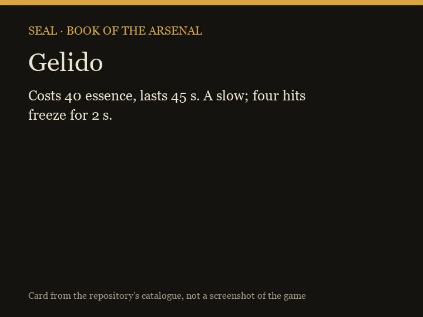

# Gelido

Gelido (*icy*) is traced with a flat palm that presses up under the receiver and slides forward under the barrel; frost grows from the
underside up the flanks, and a cold mist falls from the barrel.

## Numbers

- **Cost.** 40 essence, for 45 seconds.
- **Effect.** Each hit slows the target; four hits freeze it for two seconds.

## Standard and desert

- **Standard.** It is one of the six inner seals of the [Book of the Arsenal](../grimoires/arsenal.md).
- **Desert.** The desert doc describes no seals or books.

## Related

- [The Book of the Arsenal](../grimoires/arsenal.md): the book this seal belongs to.
- [Morsa di Gelo](../spells/morsa-di-gelo.md): the frost spell of the other book.
- [Essence](../pickups/essence.md): the resource it spends.
