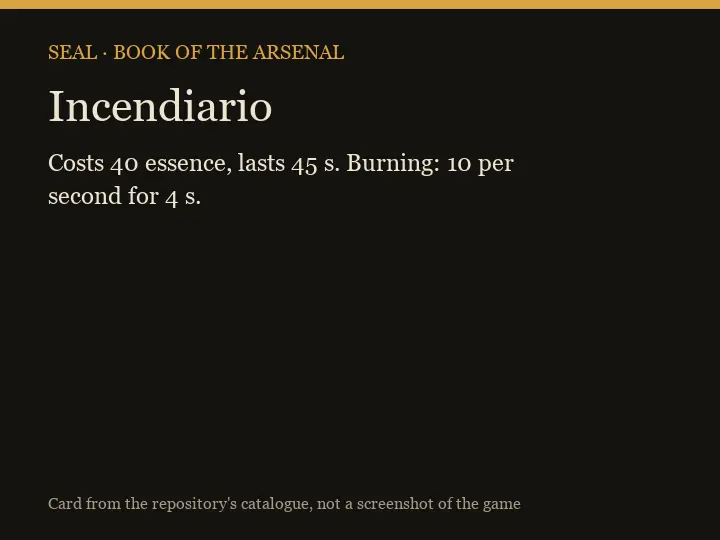

# Incendiario

Incendiario (*incendiary*) is lit with a snap under the receiver, then a flat palm slides forward under the barrel, and the metal heats from
below with the heat climbing the flanks in tongues.

## Numbers

- **Cost.** 40 essence, for 45 seconds.
- **Effect.** Burning of 10 damage a second for four seconds.

## Standard and desert

- **Standard.** It is one of the six inner seals of the [Book of the Arsenal](../grimoires/arsenal.md).
- **Desert.** The desert doc describes no seals or books.

## Related

- [The Book of the Arsenal](../grimoires/arsenal.md): the book this seal belongs to.
- [Sanguinamento](sanguinamento.md): the seal that bleeds instead.
- [Essence](../pickups/essence.md): the resource it spends.
