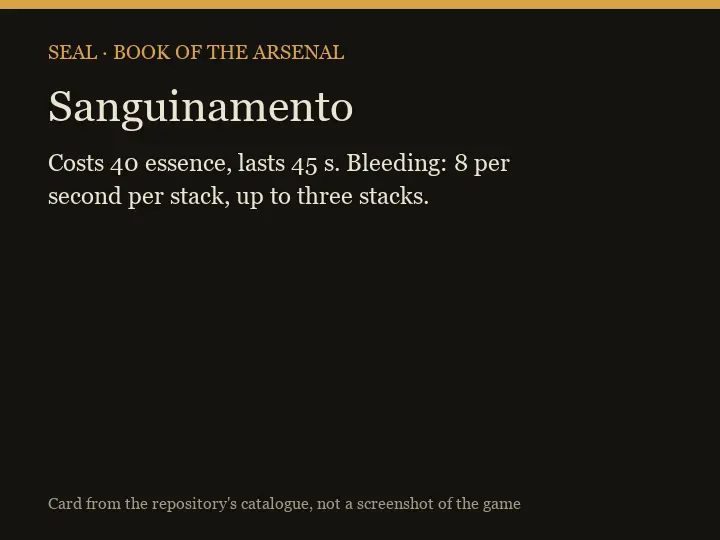

# Sanguinamento

Sanguinamento (*bleeding*) is traced by gripping the barrel from below and wringing it back toward the receiver: dark blood rises from the
metal where the hand passes and drips from the underside.

## Numbers

- **Cost.** 40 essence, for 45 seconds.
- **Effect.** A bleed of 8 damage a second for each stack, up to three stacks.

## Standard and desert

- **Standard.** It is one of the six inner seals of the [Book of the Arsenal](../grimoires/arsenal.md).
- **Desert.** The desert doc describes no seals or books.

## Related

- [The Book of the Arsenal](../grimoires/arsenal.md): the book this seal belongs to.
- [Incendiario](incendiario.md): the seal that burns instead.
- [Essence](../pickups/essence.md): the resource it spends.
