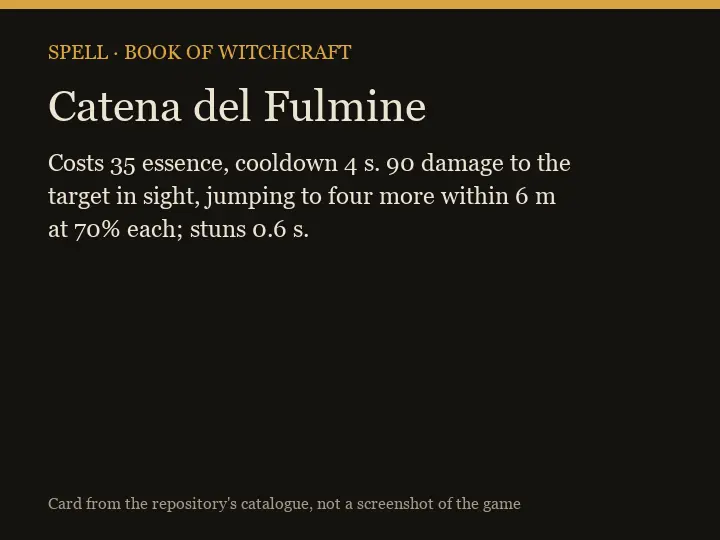

# Catena del Fulmine

Catena del Fulmine (*chain of lightning*) is cast with a raised claw, trembling, with sparks between the fingertips; a jerk forward with the
fingers splayed.

## Numbers

- **Cost.** 35 essence.
- **Cooldown.** 4 seconds.
- **Damage.** 90 to the target in sight. The chain jumps to four more enemies within 6 m, each at 70% of the hit before.
- **Stun.** 0.6 seconds.

## Standard and desert

- **Standard.** It is an inner node of the [Book of Witchcraft](../grimoires/witchcraft.md), bought in the book's secret room.
- **Desert.** The desert doc describes no spells or books.

## Related

- [The Book of Witchcraft](../grimoires/witchcraft.md): the book this spell belongs to.
- [Fiamma Sacrilega](fiamma-sacrilega.md): the fireball of the same book.
- [Essence](../pickups/essence.md): the resource it spends.
