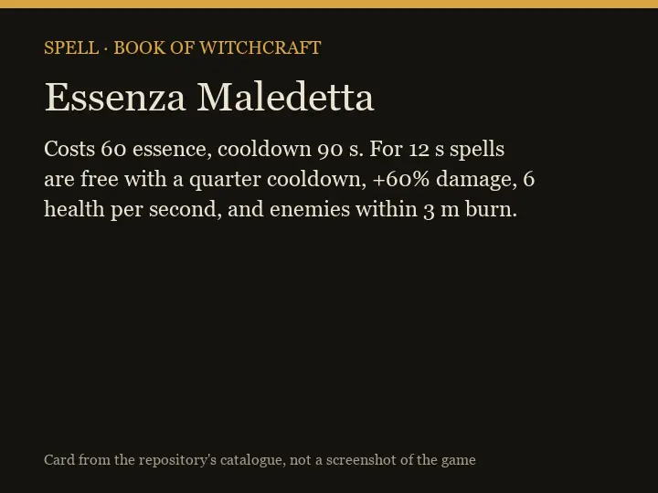

# Essenza Maledetta

Essenza Maledetta (*cursed essence*) is the seventh spell of the Book of Witchcraft, the one that the book keeps at its top. It is cast with
the palm before the face, red veins climbing the arm, and the fingers closing slowly into a claw.

## Numbers

- **Cost.** 60 essence.
- **Cooldown.** 90 seconds.
- **Duration.** 12 seconds: spells are free and their cooldown is a quarter; damage is up 60%; you lose 6 health a second; enemies within 3 m burn.

## Standard and desert

- **Standard.** It is the top node of the [Book of Witchcraft](../grimoires/witchcraft.md), bought when the book's inner nodes allow it.
- **Desert.** The desert doc describes no spells or books.

## Related

- [The Book of Witchcraft](../grimoires/witchcraft.md): the book this spell belongs to.
- [Fiamma Sacrilega](fiamma-sacrilega.md): the first spell.
- [Essence](../pickups/essence.md): the resource it spends.
