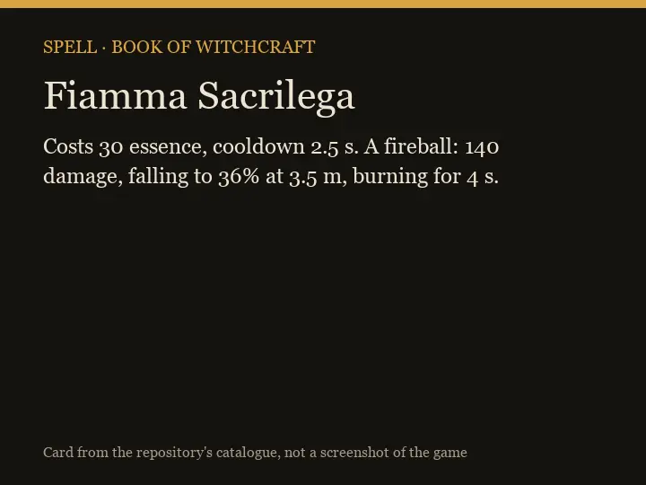

# Fiamma Sacrilega

Fiamma Sacrilega (*sacrilegious flame*) is a fireball cast with the left hand: a palm turned up, the flame born in the cupped fingers, a
push-throw with the fingers opening.

## Numbers

- **Cost.** 30 essence.
- **Cooldown.** 2.5 seconds.
- **Damage.** 140 at the centre, falling to 36% at 3.5 m.
- **Burning.** Four seconds.

## Standard and desert

- **Standard.** It is the first inner node of the [Book of Witchcraft](../grimoires/witchcraft.md), so it is bought in the book's secret room.
- **Desert.** The desert doc describes no spells or books; see the book's page for what the desert does not have.

## Related

- [The Book of Witchcraft](../grimoires/witchcraft.md): the book this spell belongs to.
- [Essence](../pickups/essence.md): the resource it spends.
- [Catena del Fulmine](catena-del-fulmine.md): the lightning spell of the same book.
