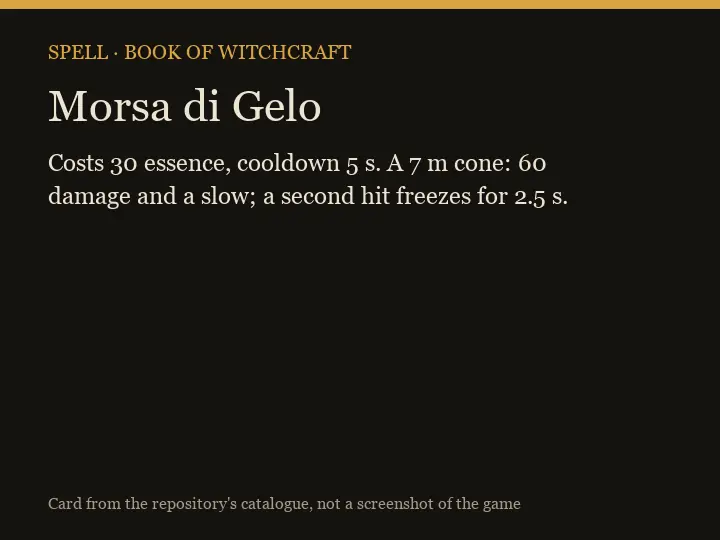

# Morsa di Gelo

Morsa di Gelo (*frost grip*) gathers frost in the palm turned toward the face, then the hand turns forward, flat, and pushes; it is held while
the cone leaves the hand.

## Numbers

- **Cost.** 30 essence.
- **Cooldown.** 5 seconds.
- **Cone.** 7 m long: 60 damage and a slow.
- **Freeze.** A second hit freezes the enemy for 2.5 seconds.

## Standard and desert

- **Standard.** It is an inner node of the [Book of Witchcraft](../grimoires/witchcraft.md), bought in the book's secret room.
- **Desert.** The desert doc describes no spells or books.

## Related

- [The Book of Witchcraft](../grimoires/witchcraft.md): the book this spell belongs to.
- [Onda del Dodecaedro](onda-del-dodecaedro.md): the other area spell.
- [Essence](../pickups/essence.md): the resource it spends.
