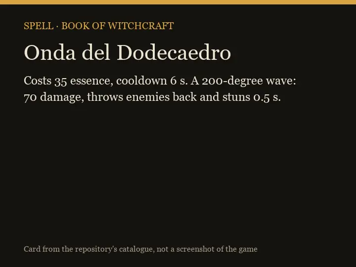

# Onda del Dodecaedro

Onda del Dodecaedro (*wave of the dodecahedron*) is cast with the fist pulled to the chest, then an explosive open-palm thrust.

## Numbers

- **Cost.** 35 essence.
- **Cooldown.** 6 seconds.
- **Wave.** 200 degrees in front of you, 70 damage. It throws enemies back and stuns them for 0.5 seconds.

## Standard and desert

- **Standard.** It is an inner node of the [Book of Witchcraft](../grimoires/witchcraft.md), bought in the book's secret room.
- **Desert.** The desert doc describes no spells or books.

## Related

- [The Book of Witchcraft](../grimoires/witchcraft.md): the book this spell belongs to.
- [Morsa di Gelo](morsa-di-gelo.md): the other area spell.
- [Essenza Maledetta](essenza-maledetta.md): the supreme spell of the book.
