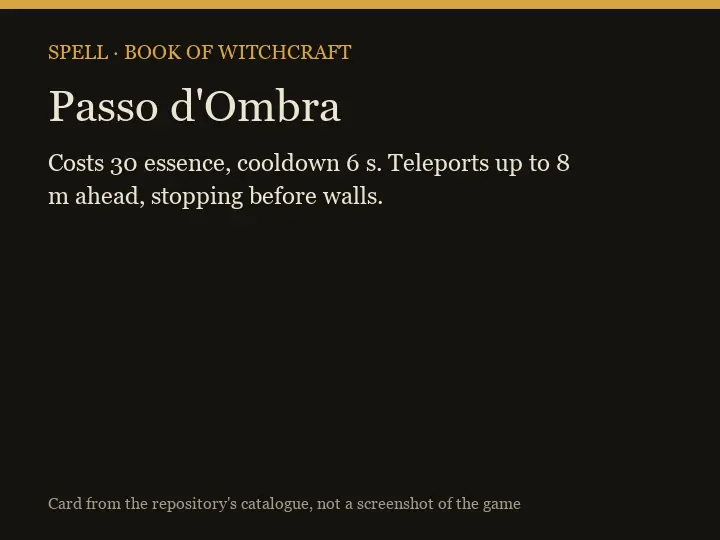

# Passo d'Ombra

Passo d'Ombra (*step of shadow*) is cast with the hand rising, the thumb on the middle finger, and a snap.

## Numbers

- **Cost.** 30 essence.
- **Cooldown.** 6 seconds.
- **Reach.** A teleport up to 8 m ahead. It stops before walls.

## Standard and desert

- **Standard.** It is an inner node of the [Book of Witchcraft](../grimoires/witchcraft.md), bought in the book's secret room.
- **Desert.** The desert doc describes no spells or books.

## Related

- [The Book of Witchcraft](../grimoires/witchcraft.md): the book this spell belongs to.
- [Essence](../pickups/essence.md): the resource it spends.
- [Onda del Dodecaedro](onda-del-dodecaedro.md): the spell that pushes enemies away.
