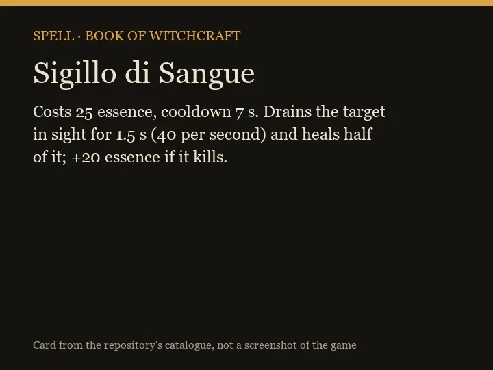

# Sigillo di Sangue

Sigillo di Sangue (*blood seal*) is cast with horns toward the target, then a claw is pulled slowly to the chest while blood flows to the
palm, and the fist squeezes.

## Numbers

- **Cost.** 25 essence.
- **Cooldown.** 7 seconds.
- **Drain.** 1.5 seconds on the target in sight, 40 a second. It heals you by half of what it drains.
- **Kill.** If it kills, you get 20 essence back.

## Standard and desert

- **Standard.** It is an inner node of the [Book of Witchcraft](../grimoires/witchcraft.md), bought in the book's secret room.
- **Desert.** The desert doc describes no spells or books.

## Related

- [The Book of Witchcraft](../grimoires/witchcraft.md): the book this spell belongs to.
- [Essence](../pickups/essence.md): the resource it spends and gives back.
- [Sete di sangue](../perks/sete-di-sangue.md): the perk that also feeds on kills.
