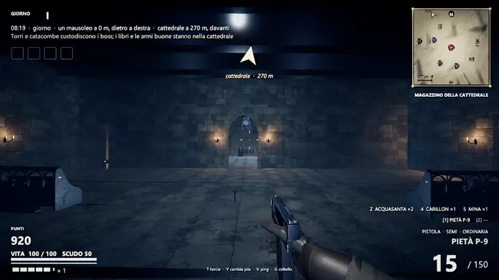

# The catacomb (desert stack)

The catacomb is the way down in the desert. A mausoleum stands on the sand; its stair goes down through a well and reaches three to five
levels of rooms under the ground, and the boss waits in the hall of the bottom level.

## How it is built

- **Levels.** The levels are 5.4 m apart, down to 21.6 m under the entrance of a five-level catacomb. Each level is built by the same
  generator as the towers: a stair room, a hall and five other rooms.
- **The entrance.** The stair goes down through a well cut in the sand. The sand round the well is cut so that the hole is clean.
- **The boss.** The bottom hall holds the boss. It is one of the four branch bosses, chosen by the place. See
  [the lord of the place](../enemies/signore-del-luogo.md).
- **Under the sand.** Below the surface the sand's props are not sent to the graphics card at all, and the world's height is negative,
  so the lights and the fog of the rooms are measured from each room's own floor.

## Standard and desert

The standard game's catacombs are the floors below the cathedral: branches of three levels, reached through the five gates behind the
apse (see [the catacombs](../zones/catacombs.md)). The desert catacomb is a stack of three to five levels, entered from the sand; the
standard gates of the descent are not built in the desert.

## Related

- [The tower](tower.md): the stack that goes up instead.
- [The holy land](../regions/holy-land.md) and [the badlands](../regions/badlands.md): regions where catacombs stand.
- [The lord of the place](../enemies/signore-del-luogo.md): the boss at the bottom.
- [The desert](../modes/desert.md): the open world as a whole.
