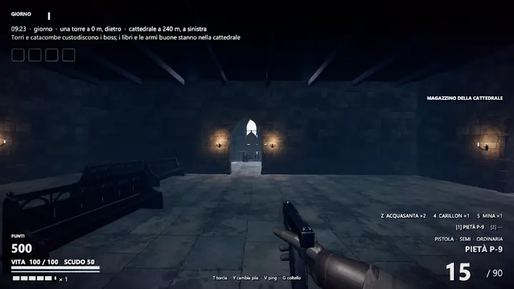

# The tower (desert stack)

The tower is the tallest building of the desert. It is a stack of floors built from the rooms of the standard game: seven to fourteen
floors, up to 76 m high. It is built to be seen from the sand, and its boss waits in the hall of the top floor.

## How it is built

- **Levels.** The levels are joined by a stair room with two flights. The stair room is the same on every level, and each level has a hall
  and five other rooms, made by the same generator as the standard floors.
- **The top.** A tower whose top floor is intact has a flat roof with battlements, four corner turrets (a stone box with a pyramid roof and
  a slit window on each outward face), a mast with a banner in the middle of the roof, and a cloth banner under the cornice of each long wall.
  A ruined tower has none of the banners.
- **The boss.** On the top floor is a hall with the boss. Its title and trophy are those of one of the four branch bosses of the cathedral,
  chosen by the place. See [the lord of the place](../enemies/signore-del-luogo.md).
- **The foot.** Where the entrance level meets the sand, drifts of sand lie against the walls.

Each tower is made when you come within 340 m of it, and its far skin, the outside without the small details, is visible from 760 m.

## Standard and desert

The standard game's tower is the set of floors you climb through the branches of the catacombs (see [the catacombs](../zones/catacombs.md)).
The desert's tower is a stack of floors too, but it is also built as an outside that stands on the sand. The desert does not build the
standard gates of the descent.

## Related

- [The catacomb](catacomb.md): the other kind of stack, which goes down instead of up.
- [The landmark tower](../landmarks/landmark-tower.md): the tower that stands at 350 m from the cathedral.
- [The badlands](../regions/badlands.md) and [the dead town](../regions/dead-town.md): regions where towers stand.
- [The desert](../modes/desert.md): the open world as a whole.
