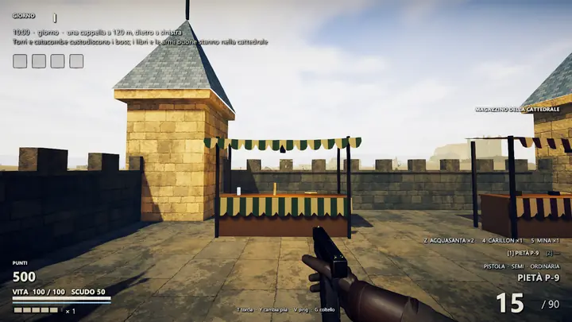

# Il banco dell'armaiolo

The armourer sells the tools of defence: the mine that a reliquary hides, the carillon that calls the enemies, and a letter of credit.

## What it sells

| Offer | Price (oboli) | Stock per return | What it does |
| --- | --- | --- | --- |
| [Reliquary mine](../traps/reliquary-mine.md) | 45 | 2 | a mine you lay on the floor |
| [Carillon](../throwables/carillon.md) | 25 | 2 | a throwable that draws the enemies to it |
| Letter of credit (*Lettera di credito*) | 60 | 2 | +500 points at the start of the expedition |

## Standard and desert

The same counter in both modes: the desert keeps the cathedral's market as it is. See [the desert](../modes/desert.md).

## Related

- [La bottega della speziale](speziale.md): the apothecary, the next stall along the square.
- [Points and oboli](../pickups/points.md): the coins that pay for the counter.
- [The cathedral](../zones/cathedral.md): where the four stalls stand.
