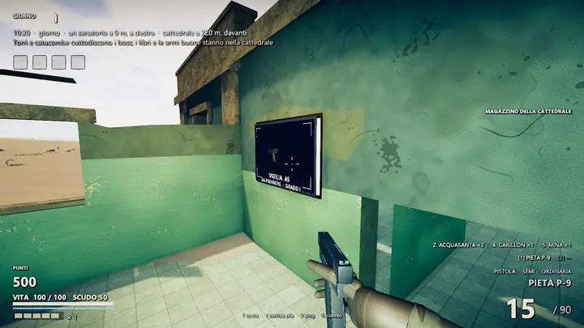

# Il carro dell'ossaio

The cart of the ossuary trades the common resources, the ones that build most of the cathedral.

## What it trades

| Lot of ten | Buy (oboli) | Sell back (oboli) | Stock per return |
| --- | --- | --- | --- |
| [Ossa (bones)](../resources/ossa.md) | 25 | 8 | 3 lots |
| [Legno (wood)](../resources/legno.md) | 30 | 10 | 3 lots |
| [Acciaio (steel)](../resources/acciaio.md) | 40 | 12 | 3 lots |

Buying costs more than selling back, so the cart can never be used to make oboli. Boss resources are never traded here.

## Standard and desert

The same cart in both modes: the desert keeps the cathedral's market as it is, and its common resources come from the sand. See
[the desert](../modes/desert.md).

## Related

- [The cathedral](../zones/cathedral.md): where the works that need these resources stand.
- [Il banco dell'armaiolo](banco-armaiolo.md) and [La tenda del cerusico](tenda-cerusico.md): the other two counters that trade.
- [Resources](../resources/ossa.md): the whole table of resources.
