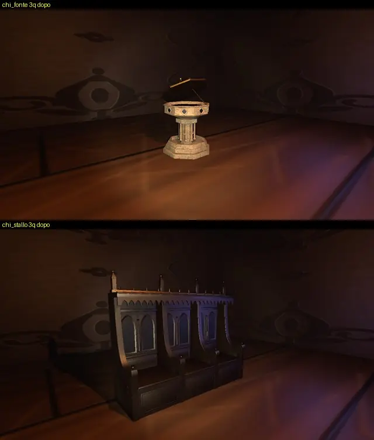

# La bottega della speziale

The apothecary is the first stall of the square. It sells what helps on the way down.

## What it sells

| Offer | Price (oboli) | Stock per return | What it does |
| --- | --- | --- | --- |
| [Holy water](../throwables/holy-water.md) | 30 | 3 | a throwable that burns the enemies it hits |
| Votive candle (*Cero votivo*) | 120 | 1 | start the descent with the [Rinascita](../perks/rinascita.md) perk |
| Cartographer's map (*Mappa del cartografo*) | 20 | 1 | every level of the expedition is fully mapped |

The stock refills every time you come back from the catacombs. Supplies bought here are spent automatically at the start of the
next expedition.

## Standard and desert

The same stall in both modes: the desert keeps the cathedral's market as the usual one. The catacomb supplies it sells are used on the
descent, which only the standard game has; see [the desert](../modes/desert.md) and [the market](../zones/cathedral.md).

## Related

- [The cathedral](../zones/cathedral.md): the square where the four stalls stand.
- [The other stalls](banco-armaiolo.md): the armourer, the ossuary cart and the surgeon's tent.
- [Points and oboli](../pickups/points.md): the coins the stall takes.
