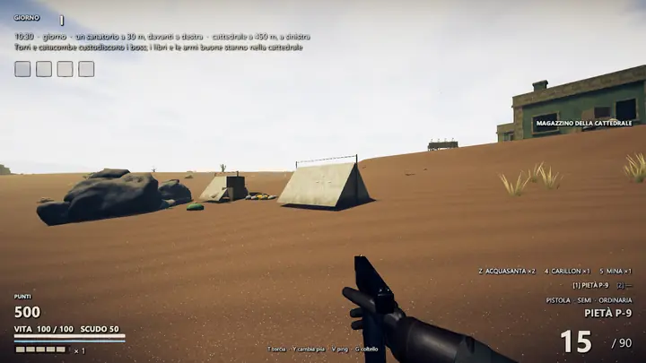

# La tenda del cerusico

The surgeon's tent trades the rare resources, one at a time. It is the only counter where a rare resource can be bought.

## What it trades

| One unit | Buy (oboli) | Sell back (oboli) | Stock per return |
| --- | --- | --- | --- |
| [Brace (embers)](../resources/brace.md) | 35 | 10 | 2 |
| [Cuori (hearts)](../resources/cuori.md) | 40 | 12 | 2 |
| [Sangue (blood)](../resources/sangue.md) | 30 | 9 | 2 |

The boss resources (relics, crystals and gems) are never traded here or anywhere else.

## Standard and desert

The same tent in both modes: the desert keeps the cathedral's market as it is. See [the desert](../modes/desert.md).

## Related

- [The cathedral](../zones/cathedral.md): the works that the rare resources build.
- [Il carro dell'ossaio](carro-ossaio.md): the cart for the common resources.
- [Resources](../resources/brace.md): the rare grade of resources.
