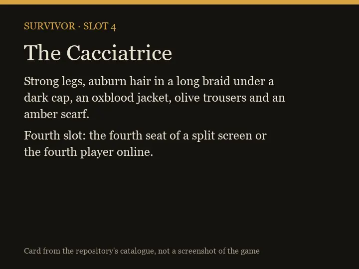

# The Cacciatrice

The Cacciatrice (the huntress) is the fourth survivor: strong-legged, with auburn hair in a long braid under a dark cap, an oxblood jacket,
olive trousers and an amber scarf. The look is slot 4.

## What it is

- **Look.** Strong legs, auburn hair in a long braid under a dark cap, oxblood jacket, olive trousers, amber scarf (characters doc).
- **Slot.** Slot 4, the fourth seat of a split screen or the fourth network slot of online co-op.
- **Character.** The look is picked with a character and stays with it; see [characters and saves](../systems/saves-and-characters.md).

## Standard and desert

- **Standard.** The same look serves both modes, and the player's own survivor is seen in the [third-person view](../systems/third-person.md).
- **Desert.** The body rides the [motorbike](../vehicles/moto.md) like the others: seated in the saddle, with hands on the grips.

## Related

- [The Custode](custode.md), [the Dottoressa](dottoressa.md) and [the Reporter](reporter.md): the other three looks.
- [Co-op](../systems/co-op.md) and [split screen](../systems/split-screen.md): where the fourth slot plays.
