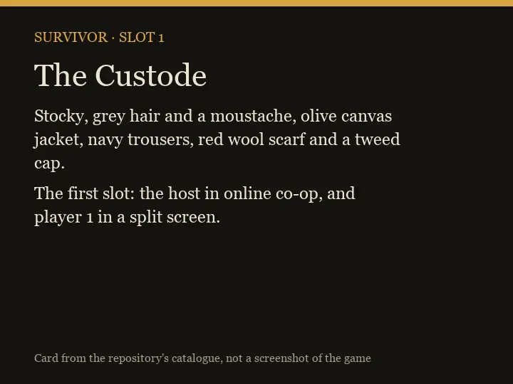

# The Custode

The Custode (the caretaker) is the first of the four survivors: stocky, with grey hair and a moustache, an olive canvas jacket, navy
trousers, a red wool scarf and a tweed cap. The look is slot 1, which is the host's in online co-op and player 1's in a split screen.

Hmm: "He" — pronoun for the Custode (a fictional character). The system instructs pronouns: "When you use a pronoun for someone... and their pronouns haven't been stated, use they/them." It's a fictional character with no stated pronouns. To be safe use "It"? Better avoid pronoun: "The Custode's look is slot 1..." Let me rewrite to avoid pronouns. I'll fix in the content: no "he".

## What it is

- **Look.** Stocky, grey hair and moustache, olive canvas jacket, navy trousers, red wool scarf, tweed cap (characters doc).
- **Slot.** Slot 1: the host in online co-op, and player 1 in a split screen.
- **Character.** The player names a character and picks a look for it when making it; the look then stays with that character. The slot decides only when no character says which look to use.

## Standard and desert

- **Standard.** The same four looks serve both modes, and the player's own survivor is seen in the [third-person view](../systems/third-person.md).
- **Desert.** The same body rides the [motorbike](../vehicles/moto.md): seated in the saddle, with hands on the grips.

## Related

- [The Dottoressa](dottoressa.md), [the Reporter](reporter.md) and [the Cacciatrice](cacciatrice.md): the other three looks.
- [Characters and saves](../systems/saves-and-characters.md): how a character keeps its look.
- [Co-op](../systems/co-op.md) and [split screen](../systems/split-screen.md): where the slots meet.
