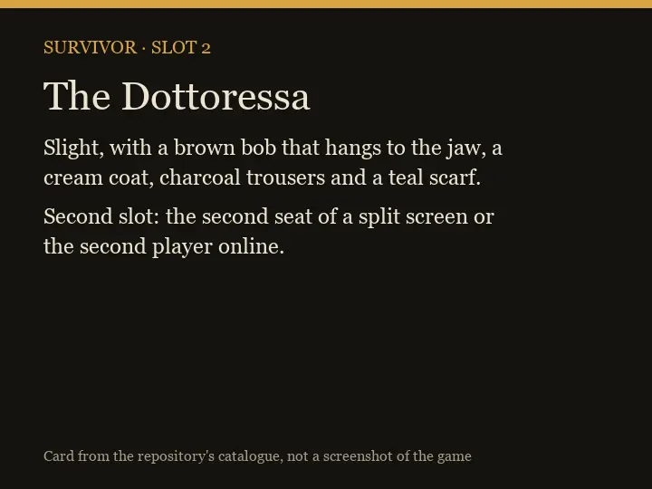

# The Dottoressa

The Dottoressa (the doctor) is the second survivor: slight, with a brown bob that hangs free to the jaw and covers the ears, parted at the
side, a cream coat, charcoal trousers and a teal scarf. The look is slot 2.

## What it is

- **Look.** Slight build, a brown bob parted at the side, cream coat, charcoal trousers, teal scarf (characters doc).
- **Slot.** Slot 2, the second seat of a split screen or the second network slot of online co-op.
- **Character.** The look is picked with a character and stays with it, as for every survivor; see [characters and saves](../systems/saves-and-characters.md).

## Standard and desert

- **Standard.** The same look serves both modes, and the player's own survivor is seen in the [third-person view](../systems/third-person.md).
- **Desert.** The body rides the [motorbike](../vehicles/moto.md) like the others: seated in the saddle, with hands on the grips.

## Related

- [The Custode](custode.md), [the Reporter](reporter.md) and [the Cacciatrice](cacciatrice.md): the other three looks.
- [Co-op](../systems/co-op.md) and [split screen](../systems/split-screen.md): where the second slot plays.
