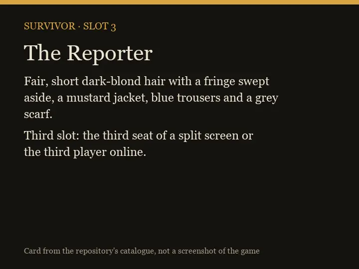

# The Reporter

The Reporter is the third survivor: fair, with short dark-blond hair and a fringe swept to the side, a mustard jacket, blue trousers and a
grey scarf. The look is slot 3.

## What it is

- **Look.** Short dark-blond hair, the fringe swept aside, mustard jacket, blue trousers, grey scarf (characters doc).
- **Slot.** Slot 3, the third seat of a split screen or the third network slot of online co-op.
- **Character.** The look is picked with a character and stays with it; see [characters and saves](../systems/saves-and-characters.md).

## Standard and desert

- **Standard.** The same look serves both modes, and the player's own survivor is seen in the [third-person view](../systems/third-person.md).
- **Desert.** The body rides the [motorbike](../vehicles/moto.md): seated in the saddle, with hands on the grips.

## Related

- [The Custode](custode.md), [the Dottoressa](dottoressa.md) and [the Cacciatrice](cacciatrice.md): the other three looks.
- [Co-op](../systems/co-op.md) and [split screen](../systems/split-screen.md): where the third slot plays.
