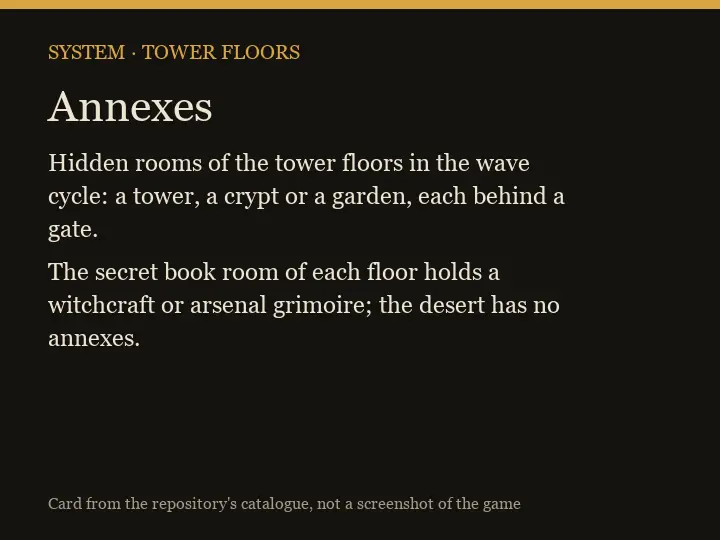

# Annexes

Annexes are the hard-to-reach rooms of the tower floors. They are planned in the survival floor plan (`PlanGen.SurvivalLayout`) as whole-number geometry, built by `FloorBuilder.Annex.cs` and `FloorBuilder.Garden.cs`, and gated by `AnnexRuntime.cs`.

## What it is

- **Tower (*Torre*).** A cell at the top of a tower, reached by a spiral staircase that is hidden in a false wall or not.
- **Crypt (*Cripta*).** A room under the floor, reached through a trapdoor.
- **Garden (*Giardino*).** A secret garden outside the walls of the floor, through a door on one of its sides.
- **Secret book room (*Sacrario*).** One per floor, behind a wall that looks like a wall and a low crawlway, outside an outer wall. It holds the witchcraft or the arsenal grimoire, a 19-node grimoire of spells for the left hand or seals for the weapons.

## Gates

Each annex is shut by one of four gates:

- **Levers** (*Sigilli*): pull the levers placed around the main hall, high and low.
- **Tribute** (*Tributo*): an altar that asks for many points.
- **Key** (*Chiave*): a key held by another annex on the same floor.
- **Secret** (*Segreto*): find the hidden wall. The secret book room uses this gate.

## Floors

Floor 1 has a crypt and a tower. Floor 2 has a tower and a garden. From floor 3 on all three appear. The secret book room is on every floor.

## Standard and desert

- **Standard.** Built into the floors of the wave cycle, the default. The legacy candle cycle is untouched by this work.
- **Desert.** None. The desert's places are houses, chapels, inns, churches, hotels, theatres, sanatoria and complexes.

## Related

- [The tower](../stacks/tower.md): the stack whose floors hold the annexes.
- [Witchcraft](../grimoires/witchcraft.md) and [Arsenal](../grimoires/arsenal.md): the grimoires of the secret book room.
- [Points and oboli](points-and-oboli.md): the tribute gate asks for points.
