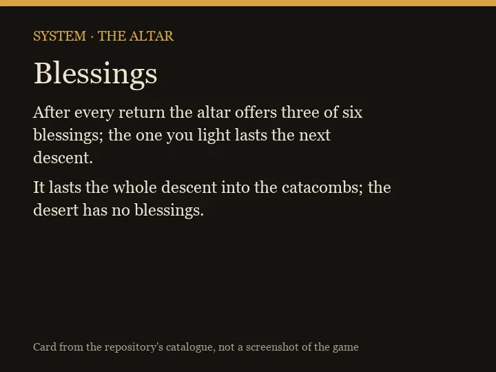

# Blessings

A blessing is a lasting gift of the altar. After every return from the catacombs the altar offers three of the six blessings. Before each expedition you light one of three candles, and the blessing you light lasts for the whole descent.

## The six

- [Furia](../blessings/furia.md): +20% damage.
- [Grazia](../blessings/grazia.md): +30 maximum health.
- [Raccolto](../blessings/raccolto.md): the resources you gather are multiplied by 1.5.
- [Provvidenza](../blessings/provvidenza.md): the power-ups drop twice as often, on the catacomb floors only.
- [Decima](../blessings/decima.md): the points from kills are 25% higher.
- [Porte d'oro](../blessings/porte-d-oro.md): the paid doors cost 30% less.

## Standard and desert

- **Standard.** Blessings belong to the catacombs of the standard game.
- **Desert.** None. No blessing appears in the desert's code (`Scripts/Deserto` has no reference to them).

## Related

- [The altar](../works/laltare-maggiore.md): the presbytery altar where the blessings are lit.
- [The catacombs](../zones/catacombs.md): the zone whose descents they last.
