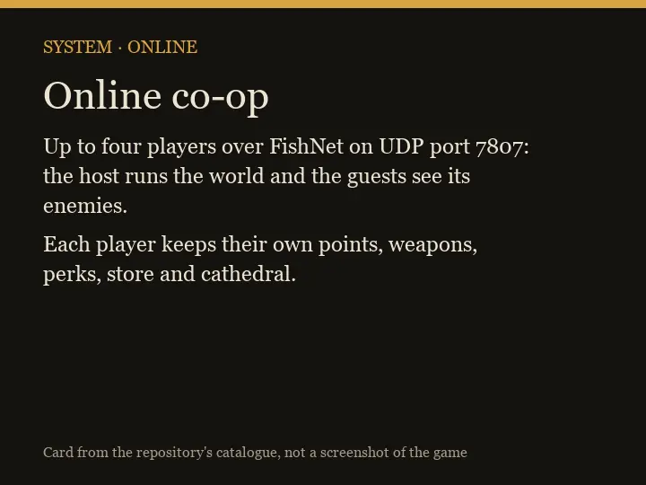

# Online co-op

Online co-op lets up to four players play the same tower or desert across the internet. The network stack is FishNet 4.7.3 over its Tugboat transport, on UDP port 7807. One player **hosts**, and the others connect to the host's address.

## How it works

- **Hosting.** The host opens **Cooperativa** from the main menu, checks the character shown there, and presses **Ospita una partita**. From 0.9.1 it also chooses *Standard* or *Il deserto*. Players who join later start where the host plays, even mid-round.
- **Joining.** Each guest opens **Cooperativa**, checks their character, types the host's address and presses **Unisciti all'indirizzo**. If the versions differ or the host does not answer, the menu says the connection was refused or got no answer.
- **Addresses.** On the same network the host's local address appears at the top of the screen and in the pause menu, or `ipconfig` shows it. Windows asks whether to allow the game on the network, and the host must say yes. Over the internet the host must forward UDP port 7807 on the router; there is no relay yet, so a connection behind CGNAT cannot be reached, and a VPN between friends (Tailscale, ZeroTier or Radmin VPN) works. The game never touches the router or the firewall.
- **Names.** Your name on the network is your character's name. The last address stays in the game's preferences.

## What is shared

One tower for everyone. The host simulates the enemies, and the guests see them. The candles, the shutters and the rounds are shared, and so are the exit and the descent: everyone goes down together. A power-up picked up counts for all.

## What is each player's own

Points, weapons, perks, the perk books, the mystery chest and the altar, the weapon walls, batteries and torch. A candle gives its 60 points, with its ammunition and the ghost bonus, to whoever lights it. A round's reward goes to everyone, a kill pays only the player who shot, and a round is cancelled only when everyone dies.

Each other player appears as one of the four survivors, with a body, a torch in hand and a name over the head. From 0.9 it is the character each player chose. The pause does not stop the others.

## Standard and desert

- **Standard.** The floors of the tower, in either cycle, with the candles, shutters and rounds shared.
- **Desert.** One world, made by every machine from the host's seed, since nothing about the world travels over the wire but the seed. The enemies (each player sees those within 190 m), the hour of the day and the boss that falls are shared. Points, weapons, perks, the cathedral, the store, the loot on the sand and the trophies stay each player's own.

## Related

- [Split screen](split-screen.md): the same game on one PC.
- [Downed and revive](downed-and-revive.md): how a teammate brings you back.
- [Characters and saves](saves-and-characters.md): the character each player brings.
- [The desert](../modes/desert.md): the desert mode.
