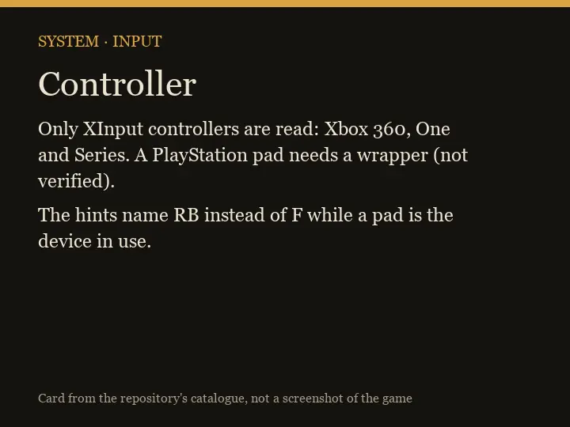

# Controller

Only XInput controllers are read: Xbox 360, Xbox One and Xbox Series, and compatible pads (`xinput1_4.dll`, with `xinput1_3.dll` as a fallback). The game works on Windows only. A PlayStation or Switch pad needs an XInput wrapper such as Steam Input or DS4Windows; this has not been verified.

## What it does

- **Adopting a pad.** The game looks at the four XInput slots twice a second and adopts the first controller on which a button is pressed, a trigger is pulled or a stick is pushed past 55%. A pad that is only plugged in is not adopted.
- **Hints.** The on-screen hints name the keys of the device used last, so `RB` appears where the keyboard says `F`. A key press or a mouse click switches them back to the keyboard names; touching the pad switches them again.
- **Map on foot.** The left stick moves and, pressed, runs. The right stick looks and, pressed, is the knife. L3 and R3 lean while aiming. X reloads; held, it uses, buys and picks up, and held for 3 seconds next to a downed teammate it revives them. RB is the holy water.
- **Menus.** The D-pad or the left stick moves, A selects and B goes back.

## Standard and desert

Both modes use the same map. Riding the desert bike with a pad has not been tried.

## Not verified

No physical controller was available. The tests answer with a fake XInput, and the real XInput read has only been checked for errors.

## Related

- [Display and menu](display-and-menu.md): the Comandi tab, with the pad sensitivity and the inverted axes.
- [Third-person view](third-person.md): the aim keys.
- [Split screen](split-screen.md): one pad per seat.
