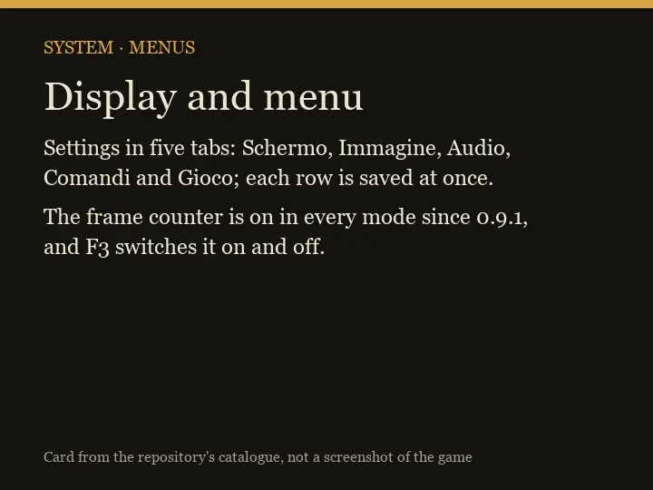

# Display and menu

The main menu is a brass-and-patina hotel register with a procedural engraving of a cathedral and an eye. The iris follows the mouse pointer or the selected entry and blinks every few seconds, dust drifts in the room, and every panel fades in. Everything that moves stands still when **Oscillazione visuale** is at zero.

The entry **Wiki**, after **Come si gioca**, opens this wiki in the browser. Each build carries a copy of it; where the copy is missing the entry is greyed out.

## Settings

Settings have five tabs. Each tab is a list of rows, sliders or choices. Every row is saved at once in the player's preferences, and **Indietro** asks nothing. **Ripristina scheda** puts the open tab back to its defaults. The Schermo tab has no such button: it is confirmed with **Applica schermo**.

| Tab | Main rows |
|---|---|
| Schermo | Screen mode, aspect, resolution, monitor refresh (exclusive full screen only), vertical sync, frame limit, Applica schermo |
| Immagine | Brightness, field of view, shadow quality, render resolution, anti-aliasing, film grain, vignette, bloom |
| Audio | Master volume, effects, music, ambience, menu theme, interface tones |
| Comandi | Aim sensitivity, pad sensitivity, Y axis for mouse and pad, aim, crouch and run (held, or one tap), command list |
| Gioco | Prospettiva, reticle, visual sway, companion HUD size, frame counter, pause when the window loses focus |

The Immagine settings touch the render pipeline asset only in the player, not in the editor and not in automated runs, so a modified asset does not stay modified. The defaults are what the asset held.

## Frame counter

The frame counter, top left, shows frames per second, milliseconds per frame and the worst frame of the last quarter of a second. It has been on in every mode since 0.9.1, and **F3** switches it on and off anywhere, the menu included.

## Standard and desert

Both modes share the menu and its settings.

## Related

- [Menu music](menu-music.md): the Tema del menu and Musica sliders.
- [Controller](controller.md): the pad rows of the Comandi tab.
- [Third-person view](third-person.md): the Prospettiva row.
