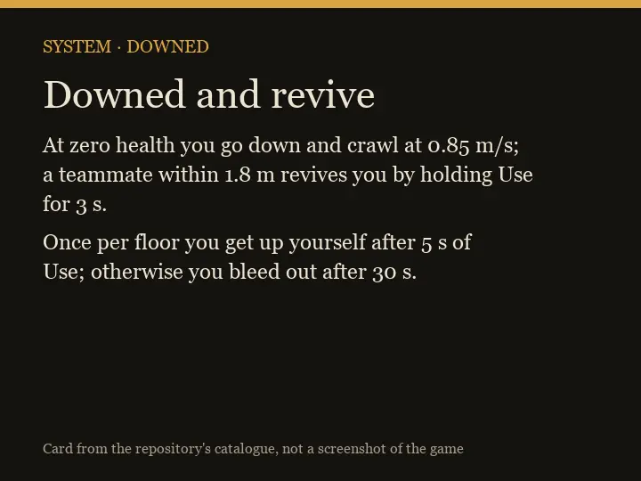

# Downed and revive

At zero health you do not die at once: you go down. Down, you crawl slowly, and a teammate can bring you back. Going down is not dying: while someone is down but alive, the wave goes on.

## What it does

- **Going down.** You crawl at 0.85 m/s with the view low and tilted. You can still fire the weapon in your hands, but you cannot run, jump, vault, use the knife, cast, throw, buy or use things. Enemies ignore you and look for someone else.
- **Rinascita.** Holding [Rinascita](../perks/rinascita.md) lifts you on the spot instead, once per floor.
- **Revive.** A teammate within 1.8 m revives you by holding Use (`F`, or `X` on a controller) for 3 seconds. You get up with half your health and 2.5 seconds of grace.
- **Getting up alone.** Once per floor you can get up yourself by holding Use for 5 seconds.
- **Bleeding out.** If nobody can revive you (you are alone and have spent the floor's self-revive, or every teammate is down or dead) you die at once. Otherwise you bleed out after 30 seconds and die.
- **Death.** The tower's penalty applies: half of your points, rounded down to tens, and the last perk you bought (see [Perks](perks.md)).

## Standard and desert

- **Standard.** A downed player in co-op is revived by a teammate. On a controller the revive is `X` held for 3 seconds next to the downed teammate, since 0.7.2.
- **Desert.** The same rules apply on foot. On the bike, going down or dying throws the rider off, and a downed player cannot mount a bike (`PlayerController.Ride.cs`). Dying costs the same as in the tower, and you wake at the top of the cathedral stair.

## Related

- [Points and oboli](points-and-oboli.md): the points that death costs.
- [Perks](perks.md): dying takes the last perk you bought.
- [The moto](../vehicles/moto.md): going down throws the rider off.
- [Co-op](co-op.md): how a teammate revives you online.
