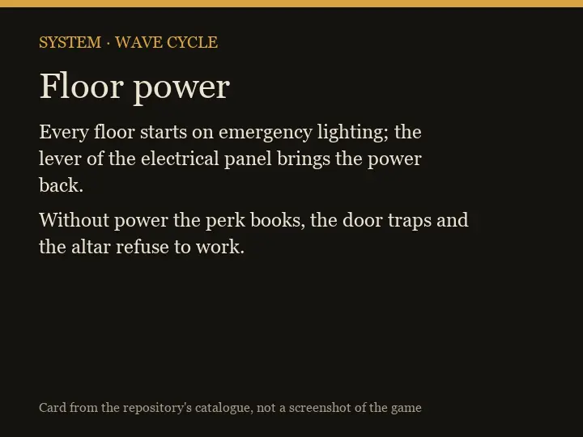

# Floor power

In the wave cycle every floor starts on emergency lighting, as in the Black Ops Zombies maps. The electrical panel hangs on a wall of the paid area farthest from the arrival, and pulling its lever brings the power back.

## What it does

- **Emergency lighting.** The electric lights run at 40% until the power is back: chandeliers, wall lamps, table and floor lamps, neon tubes, surgical lamps, theatre stage lights, gallery and atrium lamps, and the fill lights of the rooms. Candles, the red sanctuary lamp, moonlight, window light, green exit signs and the theatre eye spot are not electric, and stay as they were.
- **The panel.** An enamelled sheet-metal cabinet with indicator lamps, a dial and a warning plate, a knife switch and a caged emergency lamp that pulses red. It stands on the longest wall of the deepest area. `F` pulls the lever, for free.
- **Power on.** The lever drops with sparks, and light comes back in a wave from the panel at 28 m/s, so every lamp flickers on when the wave reaches it.
- **What needs power.** The perk books, the door traps and the Consecration altar refuse to work and say why ("Serve la corrente: trova il quadro elettrico"). The mystery chest, the wall buys and the doors work without power.
- **No panel.** In the candle cycle, with `-nopower`, or on a floor with no suitable wall, the power is on from the start.
- **Co-op.** A guest who pulls the lever sends the request, and the host turns the power on for everyone.

## Standard and desert

- **Standard.** The wave cycle, the default. The candle cycle and `-nopower` start with the power on.
- **Desert.** None. The desert's code does not use the panel.

## Related

- [The wave cycle](../cycles/wave-cycle.md): where the floors start dark.
- [Door trap: fire](../traps/door-trap-fire.md): one of the things the power unlocks.
- [Perks](perks.md): the perk books wait for the power.
- [Chandeliers](../hazards/chandeliers.md): electric lights that fall when shot.
