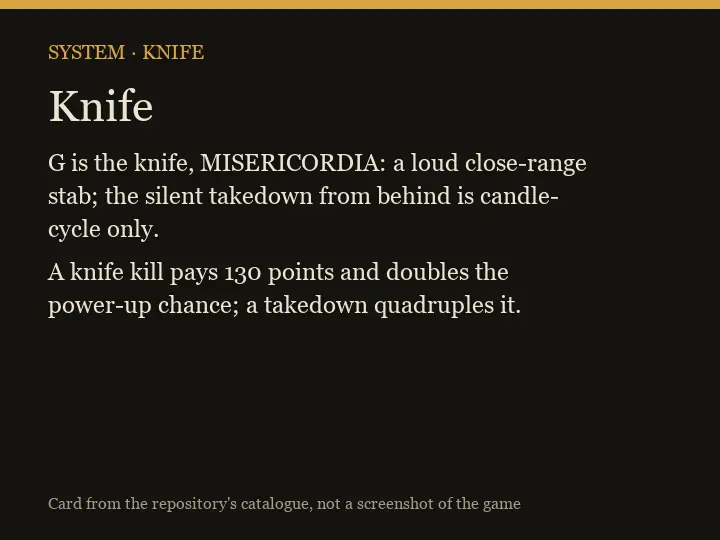

# The knife

The knife is `G` (KNIFE on the touch controls). The game calls it MISERICORDIA: it is always in your pocket and does not replace your weapon.

## What it does

- **Stab.** A slash or a stab at close range deals 120 damage, with a reach of 1.75 m. It is loud: it can be heard about 9 m away, and whoever hears it looks for you, while whoever survives knows where you are (`Knife.cs`).
- **Takedown.** Behind a monk or an abbot who is walking and has not seen you, the prompt *PRESA ALLE SPALLE* appears. The takedown is silent, kills outright, even an abbot, and is not a sighting. Its reach is 2.35 m. It exists only in the candle cycle.
- **Points.** Any knife kill pays 130 points, against 60 for a plain kill (`Punti.cs`).
- **Power-ups.** A knife kill doubles the chance of a power-up drop and a takedown quadruples it, on a base chance of 4.5% per kill (`Drops.cs`).
- **Perk.** [Sete di sangue](../perks/sete-di-sangue.md) heals 25 health per knife kill and 40 per takedown.
- **Medal.** Three knife kills within five seconds give the Lama santa [medal](medals.md) (+60).

## Standard and desert

- **Standard.** The stab works in both cycles. The takedown is a candle-cycle feature; in the wave cycle the knife is only a close-range hit.
- **Desert.** The knife works on foot, as a stab only: the desert has no stealth, so it has no takedown. On the bike the knife, the equipment, the mine and the magic are off until you get off.

## Related

- [Stealth](stealth.md): the candle cycle, where the takedown exists.
- [Medals](medals.md): Lama santa counts knife kills.
- [The moto](../vehicles/moto.md): the bike, where the knife is off.
- [Points and oboli](points-and-oboli.md): the points table.
