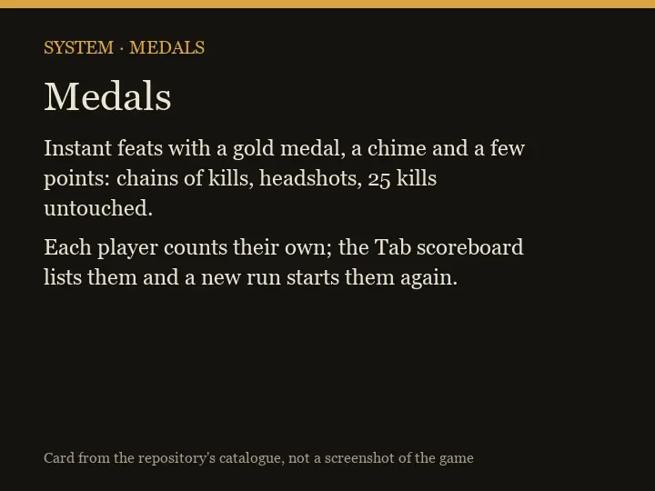

# Medals

A medal is an instant feat. It appears at the top centre of the screen as a gold medal, with its name between two rules and its points below, plays a two-note chime and pays a few points. The Tab scoreboard lists the medals of the run ("Medaglie"). They complement the wave trials.

## What it does

- **Chain.** Kills less than 0.75 seconds apart: Doppietta (two) +20, Tripletta (three) +50, Quaterna (four) +80, Strage (five) +120.
- **Mira divina.** Five headshots in a row +100; Occhio di Dio, ten in a row, +250.
- **Intoccabile.** Twenty-five kills without taking damage +150.
- **Ultimo respiro.** A kill with health at or under 15% of the maximum +50, at most once every 20 seconds.
- **Fuoco purificatore.** Three kills in one explosion +75.
- **Lama santa.** Three knife kills within five seconds +60.

## Standard and desert

Both modes. Each medal counts the kills credited to the player who made them, so in co-op and in split screen every player has their own count. A new run starts the count again. The desert uses the same kill path, so its kills count too.

## Related

- [Points and oboli](points-and-oboli.md): a medal's points go into the score.
- [The knife](knife.md): Lama santa counts knife kills.
- [Perks](perks.md): Sete di sangue heals on each knife kill.
- [The wave cycle](../cycles/wave-cycle.md): the trials that the medals complement.
