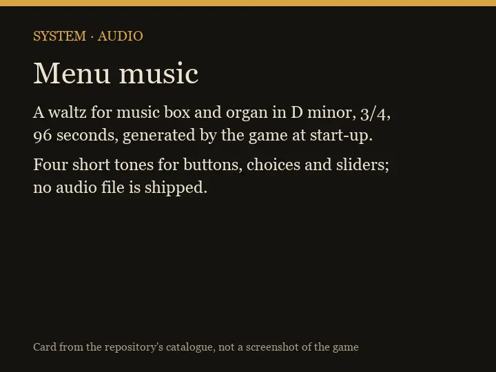

# Menu music

The main menu has a theme of its own: a waltz for music box and organ, 96 seconds long, in D minor and 3/4, generated by the game at start-up. Four short tones mark its buttons, choices and sliders. No audio file is shipped.

## What it does

- **Form.** Four parts of eight bars each: the theme; a contrast in F major with a crystal echo an octave up; the theme going out of tune; and a coda that ends on C sharp, the leading tone that leads back to the D of the next lap.
- **Playback.** It fades in over 2.5 seconds as soon as the menu is open and the clip is ready. It carries on through the screens that open from the menu (settings, guide, co-op, split screen), fades out over 1.5 seconds when the game starts, and begins again from the start when you return to the menu.
- **Volume.** The sliders **Tema del menu** and **Musica**, with the master volume, set it. While it plays, the ambience's organ and tones are lowered by up to 60%.
- **Silence.** The pause screen has no theme; there the music of the waves decides. `-nomusic` and every automated run leave the theme out.
- **Loudness.** Measured at about -23.7 LUFS in the game. The figure was measured, not listened to by ear.

## Standard and desert

Both modes share the main menu and its theme. The pause screen has no theme in either.

## Related

- [Display and menu](display-and-menu.md): the sliders and the menu.
- [Controller](controller.md): the controls of the menu.
