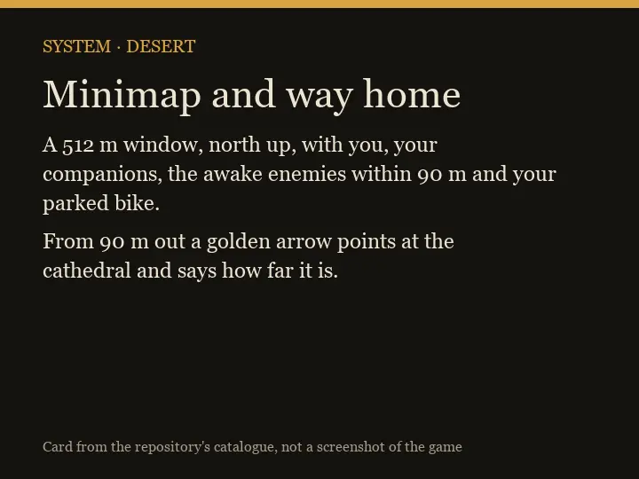

# Minimap and way home

The desert has a minimap and an arrow back to the cathedral, both added in 0.9.1. The floors have their own minimap, which **N** also shows, and a guide arrow to the lift. This page covers the desert's version.

## The minimap

- **Window.** At the top right, a window of 512 m of sand centred on you, drawn north up. **N** shows and hides it; **M** does nothing in the desert.
- **Chart.** Sand shaded as if lit from the north-west, contour lines every 3 m (stronger every 15), hatched cliffs, the pale pans of the salt flats, and the footprint of every place's rooms (filled if roofed, hatched if open to the sky). A cross marks chapels and churches, a diamond the towers, an arc the catacombs, and the cathedral has its golden stair and a circle of 42 m where no enemy is born.
- **Markers.** You, as a red arrow that turns with the view. Your companions, in their seat's colour, with a red ring that pulses when one is down. The awake enemies within 90 m, as red dots (a dark ring for a boss; a resting enemy is not drawn). Your parked bike, as a turquoise disc.
- **Night.** At night the chart turns blue and dark. Underground it is dimmer still.

## The way home

From 90 m from the cathedral's perimeter a golden arrow appears at the top centre of the screen, with the distance. It is a straight line, because the sand has no roads to follow. When the cathedral is outside the minimap's window, a golden arrow on the edge of the chart shows where it is. The arrow goes off when you are down, dead or in a transition.

## Standard and desert

- **Standard.** The floors have their own minimap and a guide arrow to the lift.
- **Desert.** The desert's minimap and arrow are the ones described above. In a split screen each seat has its own minimap, with the other seats as coloured dots.

## Related

- [The desert](../modes/desert.md): the mode these belong to.
- [Split screen](split-screen.md): each seat's minimap.
- [The moto](../vehicles/moto.md): the parked bike on the chart.
- [The cathedral](../zones/cathedral.md): what the arrow points at.
