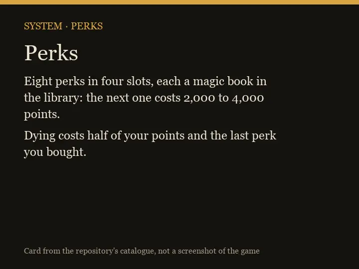

# Perks

Perks are the perks of Black Ops Zombies, kept as magic books: one book per perk. Each book has a seal in its perk's colour, and holding it changes how you play until you die.

## What it does

- **Buying.** The library (*Biblioteca*) of every tower floor has three stone lecterns in a row, each with a floating book. You buy one with `F`, and the other two close again.
- **Slots and prices.** You can hold four perks. The next book costs 2,000, 2,500, 3,000 or 4,000 points, depending on how many you already hold. With all four slots full the library offers nothing.
- **Death.** Dying costs half of your points, rounded down to tens, and the last perk you bought.

## The eight perks

- [Pelle di pietra](../perks/pelle-di-pietra.md): +50% maximum health.
- [Mani svelte](../perks/mani-svelte.md): reload 40% faster.
- [Doppio colpo](../perks/doppio-colpo.md): fire rate +33%.
- [Rinascita](../perks/rinascita.md): one rebirth per floor, on the spot, after three seconds of respite.
- [Passi di cenere](../perks/passi-di-cenere.md): footsteps heard 40% less.
- [Velo](../perks/velo.md): seen 30% less; `H` makes you invisible for five seconds.
- [Occhio della Torre](../perks/occhio-della-torre.md): the ping shows enemies through walls; headshots deal 25% more.
- [Sete di sangue](../perks/sete-di-sangue.md): knife kills heal 25 health, takedowns 40.

## Standard and desert

- **Standard.** In the candle cycle the libraries offer all eight. In the wave cycle they leave out [Velo](../perks/velo.md) and [Passi di cenere](../perks/passi-di-cenere.md), which only matter for stealth (`Biblioteca.cs`).
- **Desert.** The [Library of Vows](../works/biblioteca-dei-voti.md) stands in the nave on three lecterns, at the same prices (2,000, 2,500, 3,000, 4,000; four at most). Taking one closes the other two; 45 seconds later, with you away from the lecterns, it offers three new ones, and it tries again when the number of your perks changes. Dying costs the same as in the tower.

## Related

- [Downed and revive](downed-and-revive.md): what going down and dying cost.
- [The Library of Vows](../works/biblioteca-dei-voti.md): the desert's library.
- [The Cappella della Pietra](../works/la-cappella-della-pietra.md): the work that starts every expedition with Pelle di pietra.
- [The knife](knife.md): Sete di sangue heals on each knife kill.
