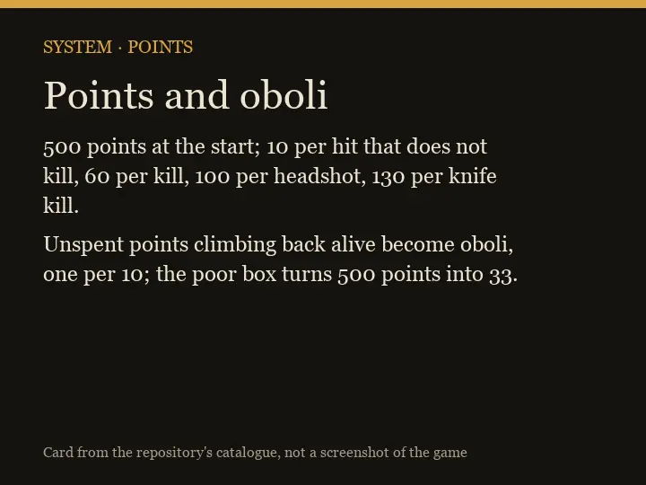

# Points and oboli

You start a run with **500 points**. Points buy doors, perks, weapons and power-ups. Oboli exist only in the catacombs.

## What it does

| Event | Points |
|---|---|
| A hit that does not kill | 10 |
| A kill | 60 |
| A lethal headshot | 100 (the lethal hit pays 60 to the body or 100 to the head, not the 10 of the hit as well) |
| A knife kill | 130 |
| A lit candle (candle cycle) | 60 |
| A round (candle cycle) | 100 plus 20 per round |
| A wave cleared (wave cycle) | 100 plus 20 per wave, for everyone |
| [Campana](../power-ups/campana.md) power-up | 400, with no points for the kills it causes |
| Ghost bonus (candle cycle) | 200 |

- **Doors.** The first area costs 500 points. Each further area costs 250 more per step of distance from the start beyond the first, up to 1,500.

## Oboli (catacombs)

- **Coming back up.** Unspent points become oboli when you climb back alive: one every 10 points, or one every 6 with [Il Tesoro](../works/il-tesoro.md).
- **Poor box.** The *cassetta delle elemosine*, next to the arrival of every catacomb level, turns 500 points into 33 oboli at once, safe whatever happens next.
- **Market.** The stalls sell supplies for the next expedition and buy and sell resources, for oboli.

## Standard and desert

- **Standard.** Points in both cycles, with the rows of the table above. Oboli exist in the catacombs of the standard game.
- **Desert.** Points are the gold coins found in rooms and out in the open, and the desert's armoury costs twice the standard price. The desert note never mentions oboli or the poor box.

## Related

- [Perks](perks.md): the price of a perk book.
- [Downed and revive](downed-and-revive.md): dying takes half of your points.
- [The satchel](satchel.md): what comes back up with you.
- [Il Tesoro](../works/il-tesoro.md): the work that makes oboli cheaper to win.
