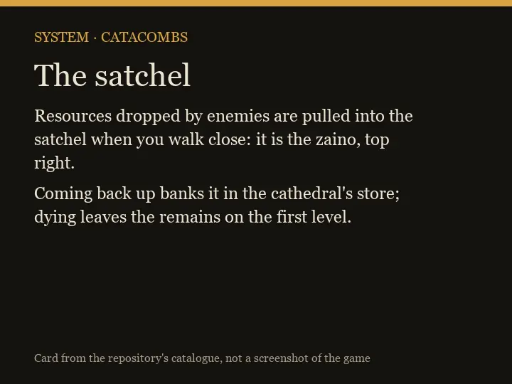

# The satchel

The satchel (*zaino*, top right of the screen) carries the resources you collect in the catacombs back to the cathedral. Enemies drop resources on the floor, and walking close pulls them into the satchel.

## What it does

- **Carrying.** Whatever is in the satchel is at risk until you come back up.
- **Coming back up.** There are three ways: the stair you came down, between waves (during a wave it is haunted and refuses); the boss of the third level of the branch, whose gate leads up instead of down; or the return bell ([Il Campanile](../works/il-campanile.md)), once per expedition, from the pause menu, even in the middle of a wave.
- **Banking.** Coming back up, everything in the satchel goes to the cathedral's store, and your unspent points become oboli.
- **Dying.** Dying ends the expedition. You wake in the cathedral with half of the common resources, rounded down, and none of the rare ones. The rest stays as your remains on the first level of that branch, marked by a column of light. Reach them on the next descent into the same branch and they go back into the satchel; dying again before that loses them for good.
- **Quitting.** Returning to the main menu during an expedition counts as dying, unless a lone player chooses *Salva e torna al menu* between two waves. The expedition is then suspended in a file of the character (see [Characters and saves](saves-and-characters.md)).

## Standard and desert

- **Standard.** The catacombs of the standard game. The tower floors have no satchel.
- **Desert.** None: the desert note says there is no satchel to bring home.

## Related

- [Points and oboli](points-and-oboli.md): the oboli your unspent points become.
- [The catacombs](../zones/catacombs.md): the zone where the satchel is used.
- [The catacomb stack](../stacks/catacomb.md): the levels of a branch.
- [Il Campanile](../works/il-campanile.md): the return bell.
