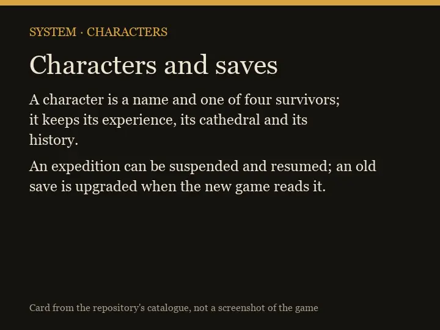

# Characters and saves

Since 0.9.0 a player is a **character**: a name and one of the four survivors' looks, chosen in the menu and kept. The character is who plays, alone, in online co-op and in split screen, and what it earns stays with it.

## What a character keeps

- Its experience and levels.
- Its own cathedral: the store, the works, the market, the blessing and the remains.
- The counters of its history.

Each character is saved in a file of its own. A save written by an older game is upgraded when the new game reads it. The format and its guarantees are in the engineering notes, and the package that holds them is [Production saves](../packages/saves.md).

## Making a character

With no character, *Gioca* opens *Nuovo personaggio*: a name, and a look chosen among the four survivors, starting with one that nobody has yet. *Crea* saves the file at once.

## Suspending an expedition

A lone player can choose *Salva e torna al menu* between two waves. The expedition is then kept in the character's file. *Gioca* offers *Riprendi la spedizione*, which resumes it, or *Ricomincia dalla cattedrale*, which abandons it, and abandoning counts as a death for the satchel. Resuming consumes the file, so two copies of one satchel never exist.

## Standard and desert

- **Standard.** Everything above applies to the tower and the catacombs.
- **Desert.** Nothing of the desert is saved. Its seed, its clock and what you took are lost when you leave; the cathedral, the store and the works are saved as always.

## Co-op, split screen and tests

In a split screen each seat plays its own character, chosen with *Chi gioca?*. In online co-op each player brings their own. Automated runs never touch the player's characters: they use a test roster (AGENTS.md, rule 14).

## Related

- [Online co-op](co-op.md): the characters on the network.
- [Split screen](split-screen.md): one character per seat.
- [The satchel](satchel.md): what a suspended expedition carries.
- [Production saves](../packages/saves.md): the package that stores the files.
