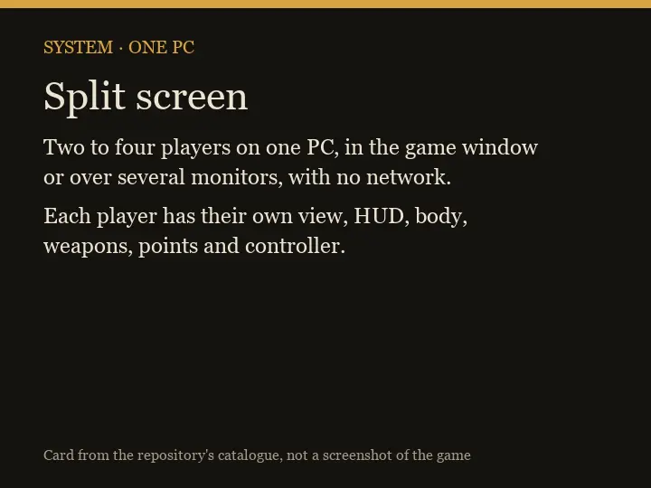

# Split screen

Several people play the same game on one PC. From the main menu choose **Schermo condiviso**, then **2 giocatori**, **3 giocatori** or **4 giocatori**. The screen is divided into equal parts, in the game window or, with more than one monitor connected, over the monitors. Every player has their own view, HUD, body, weapons, points and controller. The tower, the enemies, the waves and the lift are the same for everyone. There is no network and no second process.

## How to play

- **Controllers.** Player 1 can switch between keyboard and mouse or a controller; everyone else plays with a controller. The panel shows how many controllers the game sees and how many two players need.
- **Monitors.** With two or more monitors connected, the **Monitor** button picks how many to use.
- **Characters and world.** **Chi gioca?** asks which character plays in each seat. **Comincia** then asks *Che partita giocate?*: **Standard** (the floors, where everyone arrives side by side in the cabin of floor 1) or **Il deserto** (everyone arrives on the churchyard of the cathedral). The choice holds for every seat and is remembered.
- **Pause.** Esc, or Start on any controller, stops the whole world for everyone and hides every HUD. Unlike online co-op, nothing goes on without you.

## History

The first version, of 15 November 2026 (releases 0.6.0 and 0.6.1), opened one window per player and joined them over loopback. It was replaced on 16 November 2026, because several windows are not one game: the keyboard and the mouse follow the focus of the windows. The version described here is the second, first released in 0.6.2.

## Standard and desert

- **Standard.** The floors of the tower: one game for all, with the enemies and the waves shared.
- **Desert.** Each seat starts its own expedition. `StartDesertCo` begins one for each seat, with its own cathedral, store, points, perks and equipment. The minimap shows the other seats as coloured dots (see [Minimap and way home](minimap-and-way-home.md)).

## Related

- [Online co-op](co-op.md): the same game over the network.
- [Controller](controller.md): the controller rules.
- [Characters and saves](saves-and-characters.md): the character in each seat.
- [The desert](../modes/desert.md): the desert mode.
