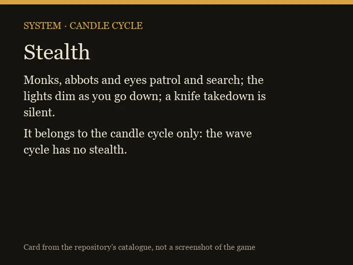

# Stealth

Stealth is the rule set of the old candle cycle, where you light the candles of each floor without being noticed. The wave cycle, the default, has none of it: no alert, no detection tied to light, no ghost bonus and no takedown.

## What it does

- **Patrols.** Monks, abbots and eyes patrol, investigate noises and search the last point where they saw you. A sign of eyes above the head shows suspicion, search or hunt.
- **Light.** The lights dim as you go down. In the dark and crouched you are harder to notice. The torch raises the distance from which you are seen; close up it dims itself, so the altar and the wall writing do not turn into white blocks.
- **Rounds.** Lighting a candle drops shutters over the exits of its zone and starts a round. A round is calm if no priest knew about you (fewer enemies, starting after 6 seconds, 150 bonus points), and on alert if someone was already searching for you (more enemies, at once).
- **Ghost bonus.** 200 points for a candle lit with no priest having seen you since the last one.
- **Takedown.** Behind a monk or an abbot who is walking and has not seen you, a knife takedown is silent and kills outright. See [The knife](knife.md).

## Standard and desert

- **Standard.** Only in the candle cycle, still available with `-candles` (or `-legacycycle`). The wave cycle has no stealth: the enemies come for you.
- **Desert.** None. The desert runs with stealth switched off (`Stealth.Enabled` is false there), and the first playtest of the desert asked for no stealth mechanics.

## Related

- [The candle cycle](../cycles/candle-cycle.md): the cycle that has stealth.
- [The wave cycle](../cycles/wave-cycle.md): the default cycle, without it.
- [The knife](knife.md): the takedown.
- [The monk](../enemies/monk.md) and [The abbot](../enemies/abbot.md): the enemies that patrol.
