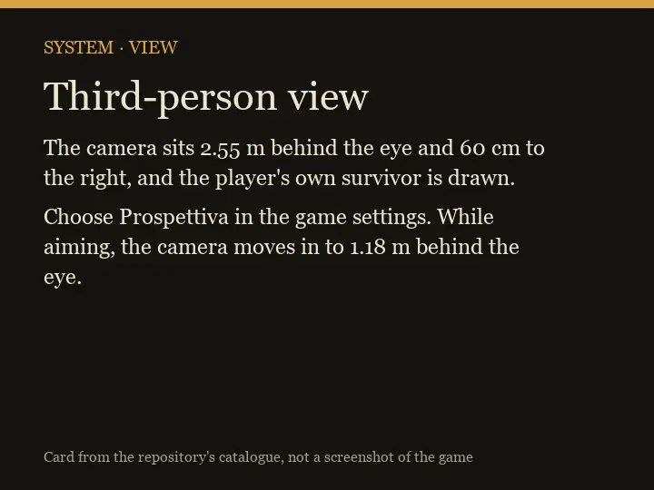

# Third-person view

Since 0.8.0 the camera can sit behind the player's shoulder and show the player's own survivor. The setting is **Prospettiva** in the *Gioco* tab: *Prima persona* (the default) or *Terza persona*. The arrow buttons and the menu keys flip it, and it is saved as `video_thirdperson`.

## What it does

- **Camera** sits 2.55 m behind the eye, 60 cm to the right and 8 cm below it. Aiming brings it to 1.18 m behind and 40 cm to the right. It moves back out gradually after an obstacle clears.
- **Body** follows your movement. Your boots stay in place during each step's contact phase, your survivor tucks their legs in the air, and their knees bend on landing.
- **Framing** can be adjusted with **Distanza 3ª persona**, **Altezza 3ª persona** and **Spalla 3ª persona** below **Prospettiva**. The values are saved.

## Standard and desert

The setting works on foot in Standard and the Desert. In the Desert the bike also supports third person, with a wider view and a return to the eye when a wall is too close. The Desert's **Select → Telecamera** page offers the same sliders.

## Related

- [Display and menu](display-and-menu.md): where the setting lives.
- [Controller](controller.md): the aim and lean keys of a pad.
