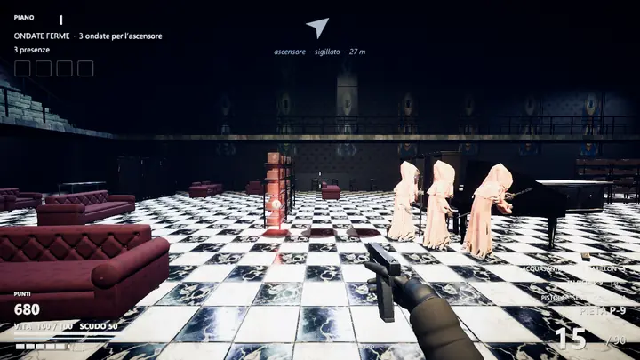

# The carillon

The carillon (*carillon*, a music box) is the second throwable of the cathedral. It does not hurt at first: it lures. It is bought at the
armourer's bench, and it is the one tool that pulls a crowd to a single point.

## What it does

- **Key and stock.** `4` throws it. You start with one, gain one every third wave, and can carry two.
- **Lullaby.** It starts playing once it settles, or after 2.5 seconds.
- **Lure.** For seven seconds every enemy within 35 m drops its target and walks to the box, except the boss and the statue.
- **Burst.** Then it explodes: 650 damage at the centre, out to 5 m. Kills pay like any explosion.
- **Barrels.** It sets off the [holy-oil barrels](../hazards/holy-oil-barrels.md) in range, and its lure can pull a crowd away from a
  door.

## Where it comes from

- **Market.** The armourer's bench sells it for 25 oboli, with two in stock for each return to the cathedral (cathedral doc).

## Standard and desert

- **Standard.** It is thrown on the catacomb floors and in the waves, with the stock rules above.
- **Desert.** The bench is one of the usual stalls, so the carillon is sold there too. The desert doc does not describe another rule for it.
- **Co-op.** A carillon thrown by a client is announced to the host, which starts the lure on the host's side, so the enemies are drawn
  there too.

## Related

- [Holy water](holy-water.md): the other throwable.
- [The armourer's bench](../stalls/banco-armaiolo.md): the stall that sells it.
- [The Appestato](../enemies/appestato.md): its burst sets off barrels, like the carillon.
