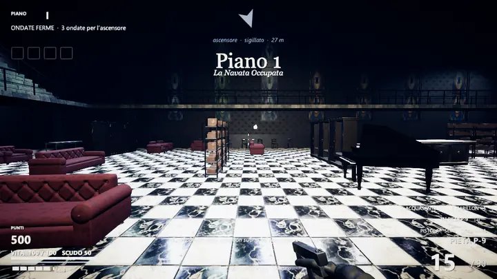

# Holy water

Holy water (*acquasanta*) is the flask you throw. It is the first of the two throwables of the cathedral, the other being the
[carillon](carillon.md). It is bought at the apothecary's stall, and the baptismal font of the cathedral keeps the supply up.

## What it does

- **Key and stock.** `Z` throws it. You start with two, you gain two more with each wave, and you can carry four. The stock refills whenever the wave number rises.
- **Throw.** It leaves the right hand at 13 m/s, with an upward push and your own velocity, and it bounces with real physics. It ignores the thrower and the enemies.
- **Burst.** After a two-second fuse the flask bursts blue-white: 420 damage at its centre, falling to 90 at 5 m, where the line of sight is needed. The thrower takes up to 30.
- **Kills.** They pay like any explosion.
- **Barrels.** The burst sets off the [holy-oil barrels](../hazards/holy-oil-barrels.md) in range.

## Where it comes from

- **Market.** The apothecary sells a flask for 30 oboli, with three in stock for each return to the cathedral (cathedral doc).
- **Font.** The [baptismal font](../works/la-fonte-battesimale.md) must hold at least three holy waters on every level.

## Standard and desert

- **Standard.** Both throwables are used on the catacomb floors, with the same key and stock.
- **Desert.** The desert keeps the market and the works as they are, so the flask is sold there too. The desert doc does not describe any other rule for throwing it.

## Related

- [The carillon](carillon.md): the other throwable, which lures and then explodes.
- [The apothecary](../stalls/speziale.md): the stall that sells the flask.
- [The holy-oil barrels](../hazards/holy-oil-barrels.md): the barrels that the burst sets off.
