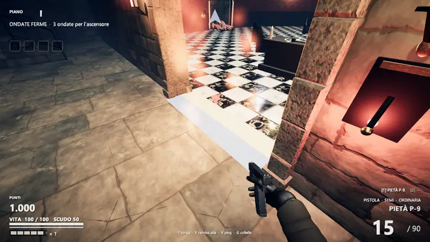

# The fire door trap

Some paid doors of the standard floors have a lever on the wall beside the opening. Once the door is bought, the lever switches a trap on:
flame tongues rise from the threshold.

## How it works

- **Price and time.** 1000 points switch it on for 20 seconds. Then it needs 40 seconds to recharge.
- **Kills.** It kills every ordinary enemy that crosses the threshold box (the opening's width, 1.8 m deep, and the opening's height), flying
  enemies included. The boss loses 8 % of its health per second.
- **Pay.** Kills pay the player who pulled the lever, 60 points each (`DamageSource.Esplosione`).
- **Players.** A player standing inside burns at 30 health per second.
- **Look.** Flame tongues rising from the threshold, a flickering orange light and a roaring loop.
- **Lever lamp.** Green when ready, red while on, amber while recharging, and dark while the door is still closed.

## Numbers

- **Count.** At most three traps per floor. A door qualifies when its opening is at least 1.2 m wide and 2 m tall, with no sill.
- **Which doors.** Every second paid door in plan order; the parity shifts with the floor number. The two kinds alternate by door.

## Co-op

The client reserves the points and sends `UseTrap`. The host accepts only if the trap is ready and its door open, replies with `TrapReply` (a
refusal refunds the points) and broadcasts `TrapsState` to everyone and to late joiners (protocol `pe-coop-20`). Only the host deals damage and
credits the kills.

## Standard and desert

The door traps exist only in the wave cycle of the standard game (the note says "survival cycle only"). No desert script refers to them.

## Related

- [The lightning door trap](door-trap-lightning.md): the same lever, price and timing, with blue arcs instead of flame.
- [The reliquary mine](reliquary-mine.md): the other trap of the standard game that kills walking enemies.
- [The catacombs](../zones/catacombs.md): the standard branches, whose floors have the paid doors.
- [The flying eye](../enemies/flying-eye.md): a flying enemy that the threshold box also kills.
