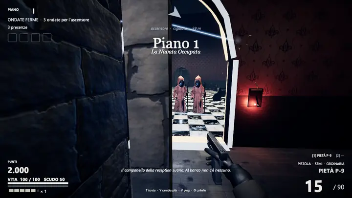

# The lightning door trap

The lightning door trap is the second kind of door trap. It sits on the same kind of paid door, and its lever works the same way. Instead of
flame, blue arcs run from one jamb to the other.

## How it works

- **Price and time.** The same as the fire trap: 1000 points switch it on for 20 seconds, and it then needs 40 seconds to recharge.
- **Look.** Blue arcs from jamb to jamb, sparks, a stuttering blue light and an electric buzz.
- **Kills.** It kills every ordinary enemy that crosses the threshold box, flying enemies included. The boss loses 8 % of its health per second.
- **Pay.** Kills pay the player who pulled the lever, 60 points each.
- **Players.** A player standing inside burns at 30 health per second, the note's figure for both kinds of trap.
- **Lever lamp.** Green when ready, red while on, amber while recharging, and dark while the door is still closed.

## Numbers

- **Count.** At most three traps per floor. The openings must be at least 1.2 m wide and 2 m tall, with no sill.
- **Kinds.** The two kinds alternate by door, so a floor has fire and lightning traps side by side.

## Co-op

The same protocol as the fire trap: the client reserves the points and sends `UseTrap`, and the host decides, replies with `TrapReply` and
broadcasts `TrapsState` (protocol `pe-coop-20`).

## Standard and desert

The door traps exist only in the wave cycle of the standard game. No desert script refers to them.

## Related

- [The fire door trap](door-trap-fire.md): the other kind, with the same lever.
- [The reliquary mine](reliquary-mine.md): the other trap, which kills walking enemies.
- [The catacombs](../zones/catacombs.md): the standard branches, whose floors have the paid doors.
