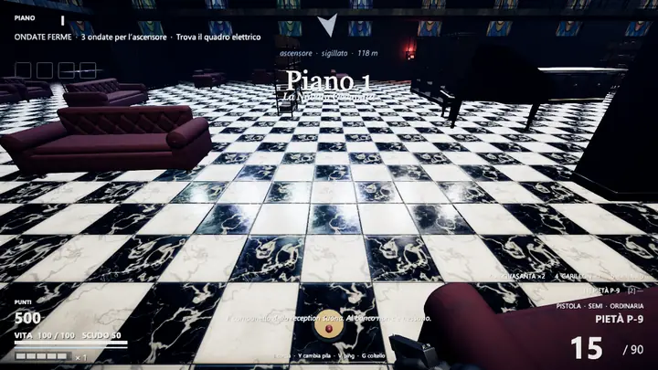

# The reliquary mine

The reliquary mine is the third piece of equipment, on key 5 (on the controller, the D-pad down, held). It is a brass disc with a cross and a
red glass dome. It is placed on the floor one metre ahead of the player.

## How it works

- **Placing.** It goes one metre ahead, on flat floor near the navmesh and with a clear line from the player; otherwise at the player's feet.
- **Arming.** It arms 1.2 s after placing, with a slow blink, and then waits.
- **Trigger.** When a walking enemy comes within 1.7 m (and 1.2 m of height), the mine blinks fast, beeps and explodes a quarter of a second
  later. Flying eyes do not trigger it.
- **Blast.** 520 damage at the centre, falling to 110 at 4.5 m with a clear line. Bodies fly away (`Enemy.NoteBlast`), and holy-oil barrels
  nearby chain-react.
- **Players.** A player never triggers it and is never hurt by it.

## Numbers

- **Count, in the wave cycle.** One at the start and one more every four waves. At most two in the pocket and three placed; placing a fourth
  sets off the oldest.
- **Lifetime.** Mines are children of the floor, so they disappear when you go down.
- **Co-op.** Everyone has their own mines, and the damage goes through the usual hit claims, as it does for the flasks.

## Standard and desert

- **Standard.** The count above applies to the wave cycle, where the waves give the extra mines.
- **Desert.** The mine works there. While you ride the [motorbike](../vehicles/moto.md), the mine is off until you get off. The desert note does
  not give a count, so the desert count is not documented.

## Related

- [Holy-oil barrels](../hazards/holy-oil-barrels.md): the barrels that the blast sets off.
- [The motorbike](../vehicles/moto.md): where the mine is off while you ride.
- [The monk](../enemies/monk.md): a walking enemy that sets the mine off.
- [The fire door trap](door-trap-fire.md): another trap, switched on by a lever.
