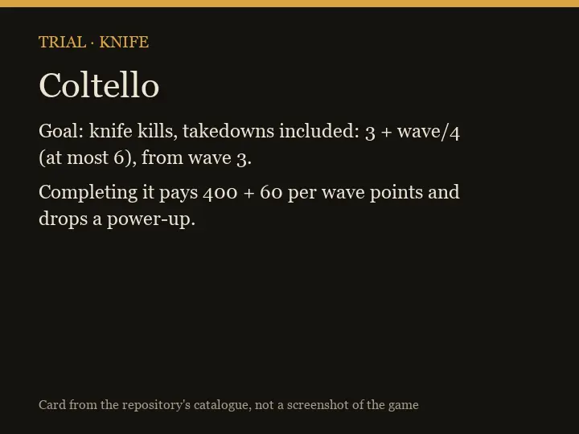

# Trial: Coltello

Coltello asks for kills with the knife: the Misericordia of the [knife](../systems/knife.md), on key G. It is the only trial that joins the draw late, from the third wave on.

## The goal

Knife kills: three plus a quarter of the wave number, at most 6. Wave 4 asks for 4, wave 8 for 5, and from wave 12 on for 6.

## How it plays

- A kill counts when the knife made it. The code also counts a takedown, the silent stab from behind, but takedowns exist only in the [candle cycle](../cycles/candle-cycle.md). In the wave cycle only the knife's own kills count.
- Coltello joins the draw from the third wave, and trials come on even waves, so it can first appear at wave 4.
- Same rules as every trial: if the wave ends first, nothing is paid. Completing it pays 400 points plus 60 per wave, and a power-up at your feet when you play alone or are the host.
- Each player counts their own knife kills in co-op.

## Standard and desert

- **Standard.** Only in the wave cycle, the default, on the even waves that are not a procession. The candle cycle has no trials.
- **Desert.** None. The desert has no waves, and its knife is a stab only.

## Related

- [The knife](../systems/knife.md): the weapon the trial counts.
- [Perk: Sete di sangue](../perks/sete-di-sangue.md): a perk that heals for every knife kill.
- [Trial: Testa](testa.md): the trial that asks for headshots instead.
- [The wave cycle](../cycles/wave-cycle.md): the waves a trial belongs to.
