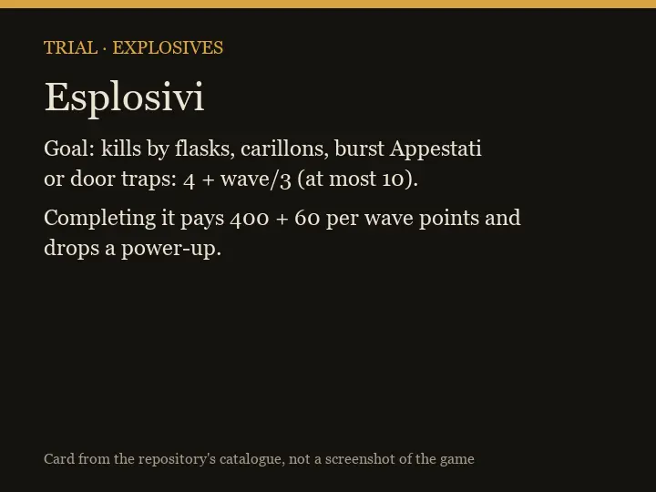

# Trial: Esplosivi

Esplosivi asks for kills by explosion. The code counts every kill credited to you whose source is an explosion (`DamageSource.Esplosione`), whatever set it off.

## The goal

Explosion kills: four plus a third of the wave number, at most 10. Wave 2 asks for 4, wave 12 for 8, and from wave 18 on for 10.

## What counts

- the bursts of the [holy-water flask](../throwables/holy-water.md) and of the [carillon](../throwables/carillon.md);
- an [Appestato](../enemies/appestato.md) that bursts from a hit of yours, and the toxic cloud it leaves;
- your [reliquary mine](../traps/reliquary-mine.md);
- the [fire door trap](../traps/door-trap-fire.md) and the [lightning door trap](../traps/door-trap-lightning.md);
- a [holy-oil barrel](../hazards/holy-oil-barrels.md) and a [falling chandelier](../hazards/chandeliers.md);
- the detonation of a sealed shot, which fires one time in sixteen.

The docs in `docs/game/equipment-and-trials.md` list only the flasks, the carillon, the Appestati and the door traps. The list above is what the code counts, so the docs are shorter than the game here.

## How it plays

- If the wave ends first, the trial is lost.
- Completing it pays 400 points plus 60 per wave, and a power-up at your feet when you play alone or are the host.
- Each player counts their own explosion kills in co-op.

## Standard and desert

- **Standard.** Only in the wave cycle, the default, on the even waves that are not a procession. The barrels, the chandeliers and the door traps are wave-cycle floor pieces of the standard game.
- **Desert.** None. The desert has no waves, so no trial comes up there, although the reliquary mine works there too.

## Related

- [Throwables](../throwables/holy-water.md): the flask and the carillon, the first two sources.
- [Reliquary mine](../traps/reliquary-mine.md): the third piece of equipment.
- [The wave cycle](../cycles/wave-cycle.md): the waves a trial belongs to.
- [Trial: Testa](testa.md): the headshot trial.
