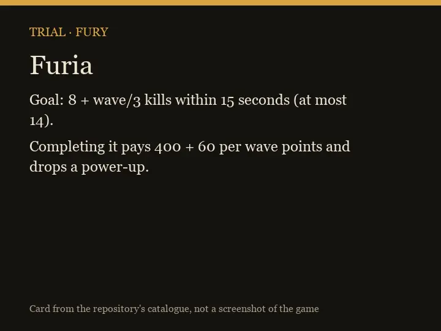

# Trial: Furia

Furia asks for a burst: many kills in a few seconds. Do not confuse it with the [blessing Furia](../blessings/furia.md) of the altar, which is +20% damage for the next expedition.

## The goal

Kills within a 15-second window: eight plus a third of the wave number, at most 14. Wave 2 asks for 8, wave 12 for 12, and from wave 18 on for 14.

## How it plays

- The window opens with the first kill. The counter shows the kills and the seconds left, for example `PROVA · Uccisioni in 15 secondi 5/10 (9 s)`.
- If the window runs out before the goal, the count goes back to zero and the window opens again with the next kill. The trial is not lost this way; only the end of the wave loses it.
- Completing it pays 400 points plus 60 per wave, and a power-up at your feet when you play alone or are the host.
- Each player counts their own kills in co-op.

## Testing

`-survivaltest` fixes the trial of every wave to [Testa](testa.md), not to a random one. Furia would complete itself on the burst kills of the test, pay its reward and drop a power-up, which would change what the test checks.

## Standard and desert

- **Standard.** Only in the wave cycle, the default, on the even waves that are not a procession. The candle cycle has no trials.
- **Desert.** None. The desert has no waves.

## Related

- [Blessing: Furia](../blessings/furia.md): the altar blessing with the same name, which is a different thing.
- [The wave cycle](../cycles/wave-cycle.md): the waves a trial belongs to.
- [Trial: Testa](testa.md): the trial that the automatic test fixes.
