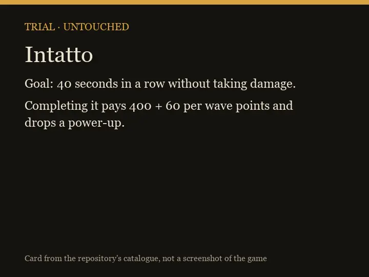

# Trial: Intatto

Intatto asks for time, not kills: forty seconds in a row without taking damage. The gold counter shows the seconds, for example `PROVA · Secondi senza essere toccato 17/40`.

## The goal

Forty seconds, the same at every wave.

## How it plays

- The count starts when the trial starts and goes up one second at a time.
- A hit resets it to zero, so the trial needs one clean run of forty seconds. A kill does not reset it.
- It is completed as soon as the count reaches forty, even while enemies are still coming. It pays 400 points plus 60 per wave, and a power-up at your feet when you play alone or are the host.
- If the wave ends before the count reaches forty, the trial is lost.

## Standard and desert

- **Standard.** Only in the wave cycle, the default, on the even waves that are not a procession. The candle cycle has no trials.
- **Desert.** None. The desert has no waves.

## Related

- [Downed and revive](../systems/downed-and-revive.md): what a hit does to you, and why one hit ends the count.
- [The wave cycle](../cycles/wave-cycle.md): the waves a trial belongs to.
- [Trial: Furia](furia.md): the trial that asks for a burst of kills instead.
