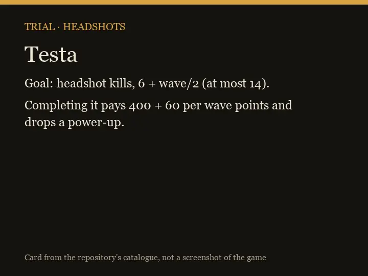

# Trial: Testa

Testa is the headshot trial. It is one of the five challenges of the [wave cycle](../cycles/wave-cycle.md). A gold line at the bottom centre of the screen shows its name and the count, for example `PROVA · Uccisioni alla testa 3/7`.

## The goal

Headshot kills: six plus half the wave number, at most 14. Wave 2 asks for 7, wave 8 for 10, and from wave 16 on for 14.

## How it plays

- A kill counts only when the shot hits the head. Body shots do not count.
- The trial lasts for its wave. If the wave ends first, or the next wave starts, it is lost and nothing is paid.
- Completing it pays 400 points plus 60 per wave: 520 at wave 2, 1000 at wave 10. It also drops one power-up at your feet when you play alone or are the host: [Reliquiario](../power-ups/reliquiario.md) (ammunition), [Offerta](../power-ups/offerta.md) (double points) or [Sguardo](../power-ups/sguardo.md) (every shot kills).
- In co-op each player has a trial of their own and counts their own kills.

## Standard and desert

- **Standard.** Only in the wave cycle, the default. A trial comes on every even wave from the second on, except a procession of lights (every fifth wave). The [candle cycle](../cycles/candle-cycle.md) has no trials.
- **Desert.** None. The desert has no waves, so it has no trials.

## Related

- [Trial: Coltello](coltello.md), [Trial: Esplosivi](esplosivi.md), [Trial: Intatto](intatto.md) and [Trial: Furia](furia.md): the other four.
- [The wave cycle](../cycles/wave-cycle.md): the waves a trial belongs to.
- [Points and oboli](../systems/points-and-oboli.md): what the reward is worth.
