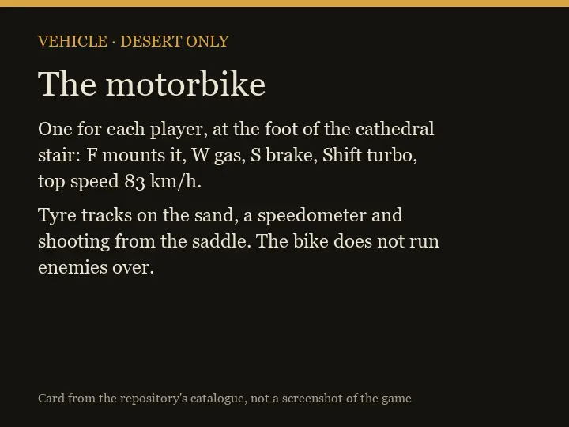

# The motorbike

The motorbike (*la moto*) is the desert's vehicle. There is one for each player, at the foot of the cathedral stair. It is a dark red
arcade bike: you mount it with **F**, steer with **A** and **D**, gas with **W**, brake or reverse with **S**, turbo with **Shift**, and
use the handbrake with **Space**; **F** gets you off again.

## Numbers

- **Top speed.** 23 m/s, which is 83 km/h. The turbo gives 31 m/s, which is 112 km/h. Reverse is 5 m/s.
- **Acceleration.** The gas takes the bike to 50 km/h in 1.8 seconds (measured); the brake takes 17 m/s², so a stop from top speed takes under two seconds.
- **Mounting.** The rider mounts within 3.1 m of the bike. The bike is let go where it stands when its rider goes down or dies.

## What it does

- **Speedometer.** A round dial at the bottom of the screen, left of the centre, while you ride. In a split screen each seat has its own.
- **Shooting from the saddle.** The weapon in your hand is stowed while you ride, with no crosshair, and it does not fire by itself. Fire,
  aim, reload and swap work from the saddle.
- **Tracks.** Each wheel that turns over 1.2 m/s leaves a ribbon of tracks on the sand.
- **Noise.** The engine is heard from far off: every 0.45 s while it moves, a noise of 7 m plus 0.85 m for each m/s of speed, up to 26 m.
- **Enemies.** Nothing runs over: in this version a bike does not hurt an enemy it passes. The rifle fired from the saddle does.

## Standard and desert

- **Standard.** The standard game has no vehicles.
- **Desert.** The bike is the open world's way across the sand, in every region. In co-op each player has a bike of their own. See
  [the desert](../modes/desert.md).

## Related

- [The Custode](../survivors/custode.md): the survivor who rides it, like the other three.
- [The desert](../modes/desert.md): the open world it crosses.
- [Co-op](../systems/co-op.md) and [split screen](../systems/split-screen.md): one bike for each player.
- [The minimap and the way home](../systems/minimap-and-way-home.md): how to find the cathedral again.
