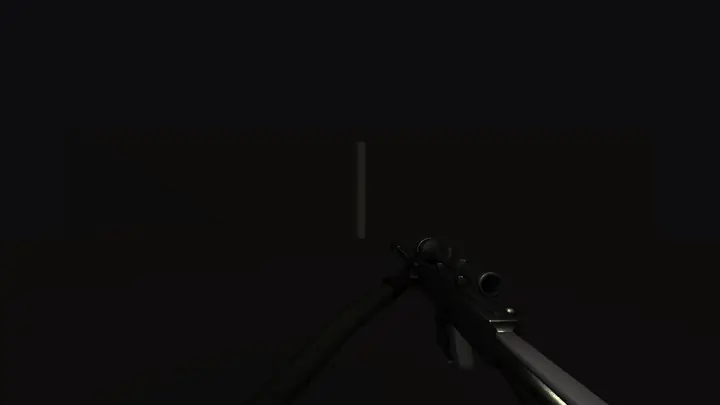

# ALTARE-50

The Altare is an anti-materiel rifle of the top grade: one shot through five enemies, with a 10x scope and five rounds.

## Numbers

| Grade | Class | Damage | Fire | Magazine | Sight |
| --- | --- | --- | --- | --- | --- |
| [V](../grades/grade-5.md) | anti-materiel rifle | 420, pierces 5 | semi | 5 | 10x scope |

## Standard and desert

The same weapon in both modes. In the desert the sand does not give grade V weapons, so the armoury is the only way to get it, at twice
the standard price. See [the desert](../modes/desert.md).

## Related

- [Weapon grades](../grades/grade-5.md): the two weapons of the top grade.
- [SENTINELLA](sentinella.md): the sniper rifle of grade IV.
- [PUPILLA](pupilla.md): the other weapon of grade V.
